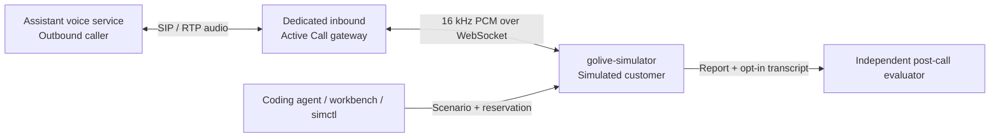

# Inbound Voice User Simulator

A simulated human customer that **answers calls from an AI voice assistant**. The assistant originates the call; the simulator picks up, follows a synthetic persona and task, and responds through audio. Use it to exercise appointment confirmations, clarification, interruptions, busy customers and call cancellation.

The intended pairing is an assistant service built by Claude and a customer simulator built by Codex. Those coding agents configure and operate the services; the live conversations use independently configured speech and language providers. The simulator is built on the [golive voice engine](README.md) and lives on branch `codex/inbound-user-simulator`.

**Current status:** implemented and tested with local mocks and isolated SIP fixtures. The first real-provider calls on 2026-10-16 exposed a pause-handling failure; the receiver fixes below still need a real-provider retest. Carrier routing and physical gateway capacity also require acceptance testing. See the [validation record](deploy/simulator/VALIDATION.md).

## How it works

The two voice services are nearly symmetric: each listens and speaks continuously through ASR → LLM → TTS. Their roles differ: the assistant calls and performs its task; the simulator receives the call and behaves like a customer. Their conversation crosses the audio connection. Scenario setup, run control and evaluation use a separate management API.



A typical run:

1. Configure a customer scenario and prepare a reservation.
2. Obtain its exact `run_id` and called SIP URI, such as `sip:sim-<unique-id>@simulator.invalid`.
3. Have the assistant-side caller dial that URI through the dedicated gateway before the reservation expires.
4. The simulator answers after the configured delay, greets the assistant and follows the scenario. Scheduled actions can interrupt or hang up.
5. Retrieve the terminal report. If transcript retention was enabled, evaluate the assistant's task performance separately.

The inbound SIP extension must preserve the exact run ID. A fixed telephone number needs an explicit route that supplies this identity. Physical phones are optional for local SIP tests; the gateway controls pickup and media. Phones become useful when testing carrier and handset behavior.

## What is included

| Capability | Purpose |
| --- | --- |
| Inbound receiver | Exact run/call/session binding, delayed answer, one greeting, bounded calls and cleanup |
| Scenario editor | Persona, task goal, synthetic facts, greeting, language, behavior and assistant expectations |
| Call behavior controls | Answer delay, duration, idle timeout, turn limits, scheduled speech, interruption and hangup |
| Voice configuration | Active settings and exportable next-start profiles for ASR, LLM, TTS, model, voice and barge-in behavior |
| Run workbench | Readiness probe, reservation target, recent runs, events, explicit stop and evidence downloads |
| Suite CLI | Sequential scenario repetitions and machine-readable targets for an external caller |
| Independent evaluator | Post-call assistant grading with cited transcript turns and separate evaluation artifacts |

Included presets cover cooperative, confused and busy customers, appointment correction and cancellation before answer. The [suite example](scenarios/suites/synthetic.json) uses a separate busy fixture whose hangup occurs before its duration limit.

## Start the local workbench

Prerequisites: Git, **Go 1.24.7 or newer**, and OpenSSL for generating tokens. Mock mode requires no provider credentials. Run the following in a new checkout:

```sh
git clone --branch codex/inbound-user-simulator --single-branch \
  https://github.com/chuanmingliu/full-duplex-go-live.git golive-user-simulator
cd golive-user-simulator

export SIM_CONTROL_TOKEN="$(openssl rand -hex 32)"
export SIM_WEBHOOK_TOKEN="$(openssl rand -hex 32)"
export SIM_MEDIA_TOKEN="$(openssl rand -hex 32)"
export SIM_DATA_DIR="$(mktemp -d "${TMPDIR:-/tmp}/golive-simulator.XXXXXX")"

go build -o /tmp/golive-simulator ./cmd/golive-simulator
go build -o /tmp/golive-simctl ./cmd/golive-simctl
/tmp/golive-simulator \
  -profile configs/simulator/mock.json \
  -addr 127.0.0.1:18865 \
  -data "$SIM_DATA_DIR"
```

Open [http://127.0.0.1:18865/sim/](http://127.0.0.1:18865/sim/) and enter the control token generated in that terminal. It stays in page memory and is cleared on disconnect. Keep these tokens available to the processes that need them; do not commit them. The simulator deliberately does not load the ordinary project's `.env.local`.

This starts the receiver and workbench. It does **not** start a SIP gateway. With no gateway, the UI and reservation API remain usable, while the gateway readiness indicator is false and calls cannot connect. Mock providers generate synthetic behavior and tones; they do not establish recognizable speech or task success.

For a complete local receiver plus gateway, follow the [isolated Docker package instructions](deploy/simulator/README.md#isolated-docker-package), using Docker Compose, Python 3 for the package validator, and the three tokens above. Building the package requires access to its pinned image and source downloads. Run the native receiver and Docker package separately: both default to host port `18865`. The package exposes HTTP only on loopback; SIP `25060` and RTP `24000–24019` stay inside its dedicated Docker network. The caller must have a route into that network. It is not a public telephone deployment.

## Configure a scenario and voice

In the workbench, choose a preset, edit it, validate it and export the exact scenario used for the run. The editor separates live customer instructions from evaluation criteria:

- **Persona, goal, facts and behavior** guide the simulated customer.
- **Expectations** describe what the assistant should accomplish. They are excluded from the live customer's prompt and checked after the call.
- **Call controls** set timing and scripted actions. `cancel_before_answer` expects the external caller to cancel; it does not originate a call or cancel one automatically.
- **Transcript retention** must be enabled before the run. The UI starts each preset with retention off, so evaluation requires an explicit choice.

The voice panel shows active provider settings and an editable profile for the **next startup**. Exporting a profile does not apply it or restart a service. Restart only this isolated simulator with the exported file when ready. Receiving audio uses fixed 16 kHz PCM.

For recognizable speech, start from [providers.example.json](configs/simulator/providers.example.json), using dedicated Tencent ASR, DeepSeek LLM and MiniMax TTS credentials in the process environment. The profile contains no credentials. See the [provider setup reference](README.md#providers) and [simulator runbook](deploy/simulator/README.md) for details.

| Provider | Environment settings |
| --- | --- |
| Tencent ASR | `TENCENT_ASR_APP_ID`, `TENCENT_ASR_SECRET_ID`, `TENCENT_ASR_SECRET_KEY` |
| DeepSeek LLM | `DEEPSEEK_API_KEY` |
| MiniMax TTS | `MINIMAX_TTS_API_KEY`, `MINIMAX_TTS_VOICE_ID`; set `MINIMAX_TTS_WEBSOCKET_ENDPOINT` if required for the account's region |

## Connect the assistant-side caller

Prepare a run through the workbench or API, then give the returned `dial_target_reference` to the caller. The hostname in that URI identifies the configured SIP domain; the caller also needs the actual gateway destination and routing. `simulator.invalid` is a logical domain, not a publicly reachable address.

A PBX may rewrite the Request-URI host to the receiving gateway. Authenticated incoming callbacks also accept the hostname from `SIM_ACTIVECALL_URL` and its resolved IP addresses, with or without a SIP port. The user part must still be the exact reserved `sim-<24 hex digits>` ID. Unrelated hosts and stale reservations are rejected; no per-container `SIM_SIP_DOMAIN` override is needed for this forwarding pattern.

Silence-suppressing gateways send no RTP between utterances. Once the call is answered and the voice session is open, the receiver fills inbound gaps of at least **100 ms** with **20 ms of zero PCM16 every 20 ms** on the wall clock. This lets VAD finish an utterance and keeps ASR receiving frames. Real audio suspends filling, and call closure stops it. These frames go only into the voice engine; they are not outgoing comfort noise or received-wire evidence. The simulator applies this automatically, including to older profiles and workbench exports.

The pinned Active Call gateway enables **symmetric RTP latching**: an eligible RTP packet from a different source IP/port than SDP can establish the outgoing media destination. This supports a PBX advertising `192.168.71.9` while media arrives through `172.20.0.1`. A supplied SDP SSRC must match, and outgoing RTP uses SDP until the first eligible inbound packet arrives. See the [gateway source audit and limits](deploy/simulator/activecall/README.md#rtp-source-address-and-latching).

The independent caller is responsible for dialing, its assistant prompt, provider configuration and call termination. There is no built-in Claude connector or outbound dial endpoint in this simulator. No text channel is used to pass conversational replies between the two services.

For repeated tests, run the CLI from another terminal with the same `SIM_CONTROL_TOKEN`:

```sh
/tmp/golive-simctl suite \
  --file scenarios/suites/synthetic.json \
  --url http://127.0.0.1:18865 \
  --token-env SIM_CONTROL_TOKEN \
  --output /tmp/simulator-suite
```

For each reservation, stdout emits one JSON-lines `ready` record with `run_id`, `scenario_id`, `trial` and `called_sip_uri`. The caller consumes that record and places the call. The runner waits for its terminal report before preparing the next trial. It never dials, executes shell hooks or automatically retries a call. Output includes `summary.json` and sanitized per-run reports.

## Evaluate task performance

Protocol evidence answers questions such as whether the call was answered and a scripted action completed. Task evaluation asks whether the assistant achieved the scenario's expectations. A protocol pass does not imply a task pass.

Use a scenario with at least one expectation, such as [appointment-correction](scenarios/simulator/appointment-correction.json). Enable transcript retention before the call and complete a conversation containing both assistant and customer utterances, without run failures. Then download its report and transcript envelope, preserving the exact exported scenario. Cancellation-only runs do not qualify for this semantic evaluation. Configure a separate judge through `SIM_EVAL_BASE_URL` (an HTTPS base ending in `/v1`), `SIM_EVAL_MODEL` and `SIM_EVAL_API_KEY`, then run:

```sh
/tmp/golive-simctl evaluate \
  --scenario scenario.json \
  --report report.json \
  --transcript transcript.json \
  --output evaluation.json
```

This explicitly sends the retained, redacted transcript and synthetic task context to the configured judge. Voice-provider credentials are not reused implicitly. Identity mismatches, missing or truncated evidence, and invalid judge output remain `indeterminate`. The judge cites transcript turns, and its assessment is fallible. `evaluation.json` stays separate from the original report and does not rewrite the suite summary.

See the [CLI reference](cmd/golive-simctl/README.md) for exact input bounds, output contracts and exit codes.

## Limits and verification

- One active reservation/call per instance; reservations last 120 seconds and calls are capped at 300 seconds. Retained run history is bounded to 128 runs.
- Audio recording and scripted silence are unsupported. Transcript retention is opt-in and bounded; use synthetic identities and facts.
- Reports measure the receiver's application audio boundary, not handset playout or carrier latency.
- Gateway readiness probes its control API. They do not prove a working SIP route, cellular channel or available hardware capacity.
- Local race, browser and integration checks cover the simulator. Isolated SIP tests exercised answer, interruption and pre-answer cancellation with mock tones. The reported real-provider calls reached audio in both directions but stalled after one turn; acceptance requires a successful retest of the receiver fixes. Full-suite baseline failures are documented in the validation record.

To check binary wiring without a call, build the receiver as above and run with Python 3:

```sh
python3 deploy/simulator/check_workbench.py --binary /tmp/golive-simulator
```

This uses temporary loopback processes, fresh tokens and a fake gateway. For package tests and isolated SIP checks, use the [validation commands](deploy/simulator/README.md#validation). Connecting a real number follows the separate [carrier acceptance plan](docs/simulator-carrier-acceptance.md).

## Code and documentation map

| Path | Contents |
| --- | --- |
| [`cmd/golive-simulator`](cmd/golive-simulator) | Isolated receiving service entrypoint |
| [`internal/simulator`](internal/simulator) | Scenarios, lifecycle, gateway adapter and evidence |
| [`internal/simulatorui`](internal/simulatorui) | Embedded configuration workbench |
| [`cmd/golive-simctl`](cmd/golive-simctl) | Suite and evaluator commands |
| [`internal/simclient`](internal/simclient), [`internal/simeval`](internal/simeval) | Management client, suite orchestration and judge validation |
| [`scenarios`](scenarios), [`configs/simulator`](configs/simulator) | Synthetic fixtures, suites and provider profiles |
| [Deployment runbook](deploy/simulator/README.md) | Gateway, API, ports, isolation and startup details |
| [Workbench guide](deploy/simulator/WORKBENCH.md) | Configuration and evaluation walkthrough |
| [Validation record](deploy/simulator/VALIDATION.md) | Actual results, tested scope and remaining acceptance work |

The ordinary `golive` service and its existing deployment remain separate. The simulator uses its own binary, tokens, data directory and optional Docker project.

The task-oriented scenarios and separate evaluator were informed by [LiveKit's agent simulation approach](https://livekit.com/blog/testing-voice-agents-with-agent-simulations). LiveKit is a design reference, not a runtime dependency.
