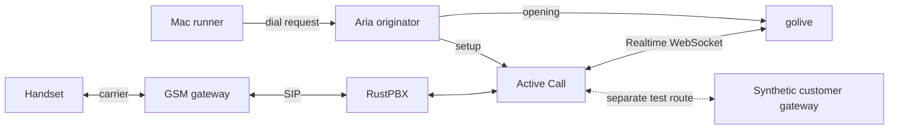

# The phone call

[Architecture index](README.md) · [Interactive explorer](explorer.html)

Source snapshot: `codex/telephony-latency` at `9547d22` · 2026-10-31.

The phone network carries sound; Aria initiates the call; RustPBX and Active Call bridge it to golive. Signalling and media are different paths. The same golive engine also accepts browser clients without the telephone infrastructure.

### Two entry points, one engine

The real phone path uses `/v1/realtime` because the media gateway speaks the OpenAI Realtime shape. Native clients can use `/v1/live/sessions`, with optional sideband attach, stored-session fork and recording content routes. Audio flows continuously; the server handles turn timing. SIP signalling is not the same transport as the audio WebSocket.

`call` uses the saved prompt and configured real recipient. `call sim` targets a reserved simulator run through its isolated gateway. Preserve call IDs throughout collection; a newer call must never silently replace the selected one.

## Components

| Component | Location | Responsibility |
| --- | --- | --- |
| [Real handset](#handset) | Owner’s phone | The human speaks and hears the assistant here. This is the endpoint that defines real telephony latency. |
| [Carrier / PSTN](#carrier) | Telephone network | Transports the real call between the handset and the GSM gateway. |
| [GSM gateway](#gsm) | Local telephone hardware | Connects the carrier-facing telephone leg to the local SIP environment. |
| [RustPBX](#pbx) | Linux box · SIP routing | Routes the SIP call between the GSM gateway and the media service. |
| [Active Call](#active) | Linux box · :8081 control | Terminates the SIP media side and connects a voice agent over the OpenAI Realtime-compatible WebSocket. |
| [Aria originator](#aria) | Linux box · :3000 | Places the outbound call and supplies the saved prompt/opening for the voice agent. |

## Real handset

The human speaks and hears the assistant here. This is the endpoint that defines real telephony latency.

**Boundary:** External. **Location:** Owner’s phone.

**Receives:** Assistant sound delivered through the telephone network.

**Produces:** Caller speech entering the carrier network.

**Operation:** Use the configured real-call command through runner.sh. After the call, wait for the owner's done signal before deep analysis.

**Boundary and limitations:** A server log timestamp is not the time sound reaches this speaker. Measure both sides on a common acoustic recording clock.

**Implementation and detailed runbooks:** [HANDSET-LATENCY.md](../../HANDSET-LATENCY.md), [CALL-OPERATIONS.md](../../CALL-OPERATIONS.md).

## Carrier / PSTN

Transports the real call between the handset and the GSM gateway.

**Boundary:** External. **Location:** Telephone network.

**Receives:** Mobile/PSTN signalling and audio in either direction.

**Produces:** Call media and signalling at the gateway or handset.

**Operation:** This is outside golive's process and server-side latency instrumentation.

**Boundary and limitations:** Radio, network and handset buffering contribute additional delay; no measured constant should be invented for this leg.

**Implementation and detailed runbooks:** [TELEPHONY.md](../../TELEPHONY.md), [HANDSET-LATENCY.md](../../HANDSET-LATENCY.md).

## GSM gateway

Connects the carrier-facing telephone leg to the local SIP environment.

**Boundary:** Infrastructure. **Location:** Local telephone hardware.

**Receives:** GSM call on one side; SIP/media through the PBX on the other.

**Produces:** Bridged telephone signalling and sound.

**Operation:** Inspect the established gateway/PBX state through phone-brain.sh status before troubleshooting a failed dial.

**Boundary and limitations:** External to this Go repository; do not confuse its buffering with model or synthesis latency.

**Implementation and detailed runbooks:** [TELEPHONY.md](../../TELEPHONY.md), [scripts/phone-brain.sh](../../scripts/phone-brain.sh).

## RustPBX

Routes the SIP call between the GSM gateway and the media service.

**Boundary:** Box / adjacent. **Location:** Linux box · SIP routing.

**Receives:** SIP call routing and its media path.

**Produces:** Call routed to Active Call or the appropriate configured endpoint.

**Operation:** The repository documents integration with an existing PBX; its implementation is maintained separately.

**Boundary and limitations:** PBX health does not establish that the golive session or physical phone audio is healthy.

**Implementation and detailed runbooks:** [TELEPHONY.md](../../TELEPHONY.md), [scripts/phone-brain.sh](../../scripts/phone-brain.sh).

## Active Call

Terminates the SIP media side and connects a voice agent over the OpenAI Realtime-compatible WebSocket.

**Boundary:** Box / adjacent. **Location:** Linux box · :8081 control.

**Receives:** SIP media; agent audio/events; explicit hangup commands.

**Produces:** Audio/events to golive at /v1/realtime and synthesized sound back to the call.

**Operation:** The telephony profile points hangup_url to :8081/command/{call}. Call identity links the gateway and golive session.

**Boundary and limitations:** The compatibility route is an API shape. It does not mean OpenAI is the speech provider on this deployment.

**Implementation and detailed runbooks:** [TELEPHONY.md](../../TELEPHONY.md), [configs/telephony.json](../../configs/telephony.json), [internal/server/realtime.go](../../internal/server/realtime.go).

## Aria originator

Places the outbound call and supplies the saved prompt/opening for the voice agent.

**Boundary:** Box / adjacent. **Location:** Linux box · :3000.

**Receives:** Authorized dial request from phone-brain.sh or the CRM.

**Produces:** A call ID, call setup, and opening coordination with golive.

**Operation:** The real dial path reads the configured allowed recipient internally. /v1/opening coordinates opening release with the call lifecycle.

**Boundary and limitations:** Starting a call is a real external action. This architecture explorer only explains the flow and never places calls.

**Implementation and detailed runbooks:** [TELEPHONY.md](../../TELEPHONY.md), [scripts/phone-brain.sh](../../scripts/phone-brain.sh), [internal/crm/service.go](../../internal/crm/service.go).
