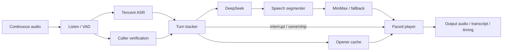

# Inside the conversation engine

[Architecture index](README.md) · [Interactive explorer](explorer.html)

Source snapshot: `codex/telephony-latency` at `9547d22` · 2026-10-31.

golive implements full-duplex behaviour with concurrent recognition, reasoning and synthesis. Listening continues while speaking. It implements the gpt-live-1 event contract and an OpenAI Realtime compatibility route; the configured backend is not a single native full-duplex speech model.

[Detailed ASR → LLM → TTS walkthrough](07-streaming-coordination.md): overlap, commitment, backpressure, revisions, interruptions and timing.

### What “full duplex” means here

Listen, transcribe, think and speak can overlap. Speculative reasoning can begin during a pause before the turn is committed. When the caller resumes, stale work must be cancelled or detached from audible playback. The engine tracks which turn and revision actually owns each piece of speech.

The current profile enables phrase-cache openers, speculative work, caller focus and interruption. It disables periodic general backchannels and holding fillers. An opener can still be reclassified as a backchannel when the caller continues; those are separate concepts. The Mac Talker experiment is not the source of these cached phrases.

### Two delegation modes

In `responses` mode, golive calls the configured backend model and translates its responses/tools into the session event contract. In `client` mode, an application receives delegation events and returns commentary or thinking context. The checked phone profile uses `responses`. Supporting an OpenAI-shaped protocol does not make this a native OpenAI realtime speech model.

### Timing and capacity

The checked profile has a 380 ms base silence threshold, 120 ms early-final request, eight requested LLM hedge copies, four-character initial text chunk and 40 ms playback chunks. These are configuration values, not independent delays to add together: much of the work overlaps. Provider account pools, rate limits and service conditions affect the actual result.

## Components

| Component | Location | Responsibility |
| --- | --- | --- |
| [golive session server](#golive) | Linux box · 127.0.0.1:8765 | Owns sessions and runs one concurrent duplex engine per session. |
| [Listen + audio front end](#listen) | internal/audio · internal/duplex | Decodes/resamples audio, detects voice activity and keeps listening during assistant playback. |
| [Tencent streaming ASR](#asr) | Tencent realtime recognition | Turns caller audio into partial and final text while speech is still arriving. |
| [Turn tracker + floor control](#floor) | internal/duplex · internal/endpoint | Decides whether to wait, answer, acknowledge or yield when someone interrupts. |
| [DeepSeek reasoning](#think) | deepseek-chat via provider adapter | Produces answer text or tool calls from the conversation, instructions and working memory. |
| [Speech segmenter](#segment) | internal/segment | Converts streaming model text into speakable chunks without waiting for the entire response. |
| [MiniMax synthesis](#tts) | MiniMax T2A WebSocket | Produces the assistant's speech audio from text chunks. |
| [Fish Audio fallback](#fish) | Configured secondary synthesizer | Provides a fallback synthesis path when the primary startup is slow or fails under the configured policy. |
| [Paced audio player](#player) | internal/duplex/playback* | Schedules audio, owns the speaking turn and records exactly when output begins or is cut. |
| [Openers + phrase cache](#phrases) | Cached speech in the engine | Plays a short acknowledgement at the pause while substantive answer work continues. |
| [Target-speaker verification](#focus) | 127.0.0.1:8032/verify | Helps reject background voices by comparing speech windows with the enrolled caller. |

## golive session server

Owns sessions and runs one concurrent duplex engine per session.

**Boundary:** Box / Go. **Location:** Linux box · 127.0.0.1:8765.

**Receives:** Continuous audio and session commands over /v1/live/sessions or /v1/realtime.

**Produces:** Streaming audio, transcripts, delegation/tool events, usage and timing evidence.

**Operation:** cmd/golive starts the service. HTTP routes include /healthz, /readyz, /metrics, /v1/opening and /v1/pool. The telephony profile is localhost-bound; other profiles support authentication and admission limits.

**Boundary and limitations:** gpt-live-1 compatibility describes the protocol. The configured implementation is Tencent ASR → DeepSeek → MiniMax.

**Implementation and detailed runbooks:** [cmd/golive/main.go](../../cmd/golive/main.go), [internal/server/server.go](../../internal/server/server.go), [internal/live/events.go](../../internal/live/events.go), [configs/telephony.json](../../configs/telephony.json), [README.md](../../README.md).

## Listen + audio front end

Decodes/resamples audio, detects voice activity and keeps listening during assistant playback.

**Boundary:** Inside golive. **Location:** internal/audio · internal/duplex.

**Receives:** Continuous PCM or supported G.711 session audio.

**Produces:** Speech windows, voice activity events and audio for recognition/focus checks.

**Operation:** The checked telephony profile uses 20 ms VAD frames, a 380 ms base silence boundary, playback-aware echo thresholds and padding.

**Boundary and limitations:** Energy thresholds and timers approximate conversational floor control; they are not a semantic speech model or a complete echo canceller.

**Implementation and detailed runbooks:** [internal/audio](../../internal/audio), [internal/duplex/listen.go](../../internal/duplex/listen.go), [configs/telephony.json](../../configs/telephony.json), [README.md](../../README.md).

## Tencent streaming ASR

Turns caller audio into partial and final text while speech is still arriving.

**Boundary:** External provider. **Location:** Tencent realtime recognition.

**Receives:** Streaming caller audio through the Tencent adapter.

**Produces:** Partial hypotheses, revisions and finalized utterance text.

**Operation:** ASR predial and an early final request at 120 ms into a pause help overlap recognition with turn-end waiting.

**Boundary and limitations:** Recognition errors and finalization delays propagate to turn decisions and answers. Audio is sent to the configured external provider.

**Implementation and detailed runbooks:** [internal/provider/tencent](../../internal/provider/tencent), [internal/duplex/listen.go](../../internal/duplex/listen.go), [configs/telephony.json](../../configs/telephony.json).

## Turn tracker + floor control

Decides whether to wait, answer, acknowledge or yield when someone interrupts.

**Boundary:** Inside golive. **Location:** internal/duplex · internal/endpoint.

**Receives:** VAD boundaries, recognized text, focus evidence and current playback state.

**Produces:** Closed or speculative turns, cancellations, accepted backchannels and barge-ins.

**Operation:** Generation/revision ownership invalidates stale speech. The profile uses semantic endpoint hints, a 700 ms patient pause and cut-on-new-query behaviour.

**Boundary and limitations:** Very short acknowledgements, background voices and late continuations are difficult cases; caller and assistant turns must retain their exact identities.

**Implementation and detailed runbooks:** [internal/duplex/listen.go](../../internal/duplex/listen.go), [internal/duplex/turn.go](../../internal/duplex/turn.go), [internal/endpoint](../../internal/endpoint), [internal/duplex/backchannel.go](../../internal/duplex/backchannel.go).

## DeepSeek reasoning

Produces answer text or tool calls from the conversation, instructions and working memory.

**Boundary:** External provider. **Location:** deepseek-chat via provider adapter.

**Receives:** Versioned conversation context, finalized/speculative caller text and tool results.

**Produces:** Streaming text deltas and structured function calls.

**Operation:** The checked profile requests eight LLM hedge copies and races a short first clause. Prefix warming overlaps work with ringing/opening; losing requests are cancelled.

**Boundary and limitations:** Hedging can spend extra tokens and cannot guarantee independent provider latency. The general protocol also supports client-side delegation instead of this backend.

**Implementation and detailed runbooks:** [internal/duplex/think.go](../../internal/duplex/think.go), [internal/provider/deepseek](../../internal/provider/deepseek), [internal/provider/hedge.go](../../internal/provider/hedge.go), [configs/telephony.json](../../configs/telephony.json), [README.md](../../README.md).

## Speech segmenter

Converts streaming model text into speakable chunks without waiting for the entire response.

**Boundary:** Inside golive. **Location:** internal/segment.

**Receives:** Text deltas from the winning model response.

**Produces:** A short first clause followed by larger sentence/phrase chunks.

**Operation:** The checked profile starts with four characters and a 100 ms first-chunk deadline; later chunks are larger. CJK and Latin boundaries are handled.

**Boundary and limitations:** Shorter chunks can reduce startup delay while making prosody harder; chunk readiness is not actual audio output.

**Implementation and detailed runbooks:** [internal/segment](../../internal/segment), [internal/duplex/engine.go](../../internal/duplex/engine.go), [configs/telephony.json](../../configs/telephony.json).

## MiniMax synthesis

Produces the assistant's speech audio from text chunks.

**Boundary:** External provider. **Location:** MiniMax T2A WebSocket.

**Receives:** Text, configured voice, language and speed.

**Produces:** Streaming synthesized audio for the player or bounded caches.

**Operation:** Provider pooling, first-audio deadlines, account rate limits and optional hedge attempts bound startup stalls. The checked profile enables a delayed Fish fallback.

**Boundary and limitations:** A synthesized chunk can still wait in the player. Model startup and account capacity are different bottlenecks from phone transport.

**Implementation and detailed runbooks:** [internal/provider/minimax](../../internal/provider/minimax), [internal/provider/hedge_tts.go](../../internal/provider/hedge_tts.go), [internal/provider/background_tts.go](../../internal/provider/background_tts.go), [configs/telephony.json](../../configs/telephony.json).

## Fish Audio fallback

Provides a fallback synthesis path when the primary startup is slow or fails under the configured policy.

**Boundary:** External provider. **Location:** Configured secondary synthesizer.

**Receives:** Text and fallback voice/provider configuration.

**Produces:** Alternative synthesized audio if this attempt wins.

**Operation:** The checked telephony profile names fish and a 320 ms fallback threshold. Provider credentials/capacity still determine availability.

**Boundary and limitations:** Configured fallback is not evidence that Fish spoke in a particular call. Voice continuity and fallback usage need per-call evidence.

**Implementation and detailed runbooks:** [internal/provider/fallback_tts.go](../../internal/provider/fallback_tts.go), [internal/provider/fish](../../internal/provider/fish), [configs/telephony.json](../../configs/telephony.json), [TELEPHONY.md](../../TELEPHONY.md).

## Paced audio player

Schedules audio, owns the speaking turn and records exactly when output begins or is cut.

**Boundary:** Inside golive. **Location:** internal/duplex/playback*.

**Receives:** Synthesized or cached PCM, turn/revision ownership and interruption commands.

**Produces:** Audio callback chunks, canonical assistant transcript, first-audio/content/readout stamps and truncation evidence.

**Operation:** The profile uses 40 ms chunks with a 300 ms lead. f842928 rebases the clock after synthesis gaps instead of backdating later audio.

**Boundary and limitations:** This boundary is before socket delivery and the handset. It proves server emission, not that the user heard the audio.

**Implementation and detailed runbooks:** [internal/duplex/playback.go](../../internal/duplex/playback.go), [internal/duplex/playback_owner.go](../../internal/duplex/playback_owner.go), [internal/duplex/playback_completion.go](../../internal/duplex/playback_completion.go), [internal/duplex/output_transcript.go](../../internal/duplex/output_transcript.go).

## Openers + phrase cache

Plays a short acknowledgement at the pause while substantive answer work continues.

**Boundary:** Inside golive. **Location:** Cached speech in the engine.

**Receives:** Caller/context-based opener selection and configured phrases.

**Produces:** Cached opener/filler audio and explicit outcome events for the journal.

**Operation:** Opener and phrase_cache are enabled in the profile. General periodic backchannel and holding_filler are disabled there; an opener may still become a backchannel if the caller continues.

**Boundary and limitations:** First filler audio is not first answer content. These phrases are not proof that the separate Talker model was used.

**Implementation and detailed runbooks:** [internal/duplex/filler.go](../../internal/duplex/filler.go), [internal/duplex/backchannel.go](../../internal/duplex/backchannel.go), [internal/journal/fillers.go](../../internal/journal/fillers.go), [configs/telephony.json](../../configs/telephony.json).

## Target-speaker verification

Helps reject background voices by comparing speech windows with the enrolled caller.

**Boundary:** Box / Python. **Location:** 127.0.0.1:8032/verify.

**Receives:** Audio windows and caller enrolment signals from the duplex engine.

**Produces:** Speaker similarity/labels used by the focus policy.

**Operation:** The checked profile uses focus=veto and the local CAM++ service, with no named persistent profile. Runtime implementation is edge/tsv_server.py.

**Boundary and limitations:** Mixtures of voices, echo and weak enrolment are uncertain cases. This identifies similarity; it does not extract a clean target voice from noisy audio.

**Implementation and detailed runbooks:** [edge/tsv_server.py](../../edge/tsv_server.py), [internal/duplex/focus.go](../../internal/duplex/focus.go), [internal/focus](../../internal/focus), [configs/telephony.json](../../configs/telephony.json), [TELEPHONY.md](../../TELEPHONY.md).
