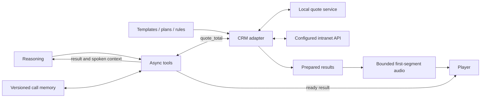

# Prompts, memory and quotations

[Architecture index](README.md) · [Interactive explorer](explorer.html)

Source snapshot: `codex/telephony-latency` at `9547d22` · 2026-10-31.

The CRM is a small lead/prompt and quotation adapter service, not a full enterprise CRM. Slow business work runs independently of the conversation. Prepared results and prepared speech reduce waiting, while explicit call, task and turn identities preserve attribution.

### Ordinary quotation path

1. The caller's request enters the model and tool coordinator.
2. `quote_total` reads the current plan and facts. Missing essential fields return a structured `need` result for a follow-up question.
3. A compatible ready result is reused, or the CRM calls the configured pricing implementation.
4. Slow work returns asynchronously with its task and caller origins preserved.
5. Deterministic speech reads the quotation; the backend receives context about what was already spoken so it can continue naturally without repeating it.

### What gets prepared

The CRM prepares the default quote while the phone rings, and can prepare a bounded set of nearby selections. The engine separately prepares the first audio segment of a bounded number of eligible results. Neither cache is a substitute for validating call identity, pricing configuration, facts, voice identity and expiry.

The local quotation service implements the intranet API contract with placeholder tables and intentional delay. Switching `quote-api.base_url` to a business service changes the adapter destination; the diagram does not assert that a production insurer connection is active.

## Components

| Component | Location | Responsibility |
| --- | --- | --- |
| [Call working memory](#memory) | Per-call engine state | Keeps facts and the selected coverage plan available across conversational turns. |
| [Async tool coordinator](#tools) | internal/duplex/tools.go | Runs slow business requests while the caller and assistant can continue talking. |
| [CRM / lead service](#crm) | Linux box · :8791 | Manages prompt templates, rendered calls, business configuration and the quotation-tool API. |
| [Templates + business configs](#prompts) | ~/golive-crm | Separates business instructions, greeting, field requirements and pricing integration from the engine. |
| [Prepared quotation results](#prequote) | Call-scoped result cache | Calculates default and bounded nearby selections before the customer requests them. |
| [Prepared quotation audio](#quoteaudio) | Call-private PCM cache | Pre-synthesizes the first speakable segment of eligible ready quotations. |
| [Local quotation service](#quotesvc) | 127.0.0.1:8793 | Implements the business quotation API locally so the entire asynchronous integration can be exercised. |
| [Business intranet API](#businessapi) | Configurable quote-api base_url | The production-facing API contract that the CRM quotation adapter can call. |

## Call working memory

Keeps facts and the selected coverage plan available across conversational turns.

**Boundary:** Inside golive. **Location:** Per-call engine state.

**Receives:** update_memory patches, explicit plan changes and normalized quotation results.

**Produces:** Versioned context included in later model requests and tool work.

**Operation:** Nested JSON patches merge, null deletes, and versions identify what an asynchronous task computed against. Quote comparisons and committed plan changes have different semantics.

**Boundary and limitations:** This is call state, not a general long-term customer database. A late result must not silently overwrite a newer selection.

**Implementation and detailed runbooks:** [internal/duplex/tools.go](../../internal/duplex/tools.go), [internal/duplex/quote_memory.go](../../internal/duplex/quote_memory.go), [internal/duplex/history.go](../../internal/duplex/history.go), [TELEPHONY.md](../../TELEPHONY.md).

## Async tool coordinator

Runs slow business requests while the caller and assistant can continue talking.

**Boundary:** Inside golive. **Location:** internal/duplex/tools.go.

**Receives:** Model function calls, memory version and call/turn identifiers.

**Produces:** Task states, tool results, controlled speech delivery and backend continuation.

**Operation:** The profile provides four tool workers. Identical in-flight requests can share work while preserving each caller origin; ready quotes can bypass unplayed waiting phrases.

**Boundary and limitations:** Cancelling speech does not necessarily undo business work. Missing, superseded and coalesced results need explicit identity and evidence.

**Implementation and detailed runbooks:** [internal/duplex/tools.go](../../internal/duplex/tools.go), [internal/duplex/coalesced_task.go](../../internal/duplex/coalesced_task.go), [internal/duplex/ready_quote_handoff.go](../../internal/duplex/ready_quote_handoff.go), [internal/tools](../../internal/tools).

## CRM / lead service

Manages prompt templates, rendered calls, business configuration and the quotation-tool API.

**Boundary:** Box / Go. **Location:** Linux box · :8791.

**Receives:** Authenticated template/config edits, render/dial requests and POST /api/tools/quote.

**Produces:** Versioned prompts, call IDs, normalized quotations and audit events.

**Operation:** cmd/crm serves a browser panel and API. Data lives in ~/golive-crm; events form a checksummed append-only chain. It is a separate process retained across an ordinary phone-service restart.

**Boundary and limitations:** Despite its name, this is a focused lead/prompt and quote service, not a completed enterprise CRM. A CRM code release requires explicit CRM replacement/restart.

**Implementation and detailed runbooks:** [cmd/crm/main.go](../../cmd/crm/main.go), [internal/crm/service.go](../../internal/crm/service.go), [internal/crm/quoteapi.go](../../internal/crm/quoteapi.go), [TELEPHONY.md](../../TELEPHONY.md), [CALL-OPERATIONS.md](../../CALL-OPERATIONS.md).

## Templates + business configs

Separates business instructions, greeting, field requirements and pricing integration from the engine.

**Boundary:** Box / stored data. **Location:** ~/golive-crm.

**Receives:** Template variables and versioned quote-plans, quote-api, quote-rules, quote-speech and opener configuration.

**Produces:** Exact rendered prompts, missing-field questions, speech wording and normalized business requests.

**Operation:** internal/jinja implements a tested Jinja-compatible subset. Unsupported syntax is rejected. Saved rendered prompts are identified by hash; the existing saved-call path can reuse a prior prompt.

**Boundary and limitations:** Template text, lead variables and rendered prompts may be private. Architecture docs contain their roles and paths, not the owner's actual content.

**Implementation and detailed runbooks:** [internal/jinja](../../internal/jinja), [internal/crm/plans.go](../../internal/crm/plans.go), [internal/crm/service.go](../../internal/crm/service.go), [internal/tools/quotespeech.go](../../internal/tools/quotespeech.go), [TELEPHONY.md](../../TELEPHONY.md).

## Prepared quotation results

Calculates default and bounded nearby selections before the customer requests them.

**Boundary:** Box / CRM state. **Location:** Call-scoped result cache.

**Receives:** Call identity, vehicle/plan facts, pricing configuration and explicit selections.

**Produces:** Ready result snapshots or ordinary foreground quote work on a cache miss.

**Operation:** Default preparation overlaps ringing. Follow-selection preparation is bounded, gives demand priority and preserves pricing/config identity. /api/quote/ready exposes eligible ready results to the engine.

**Boundary and limitations:** Caching trades extra work for latency. A result must match the call, facts, configuration and expiry; preparing every possible plan is deliberately avoided.

**Implementation and detailed runbooks:** [internal/crm/prefetch.go](../../internal/crm/prefetch.go), [internal/crm/prequote.go](../../internal/crm/prequote.go), [internal/crm/follow_selection.go](../../internal/crm/follow_selection.go), [internal/crm/quote_ready.go](../../internal/crm/quote_ready.go), [CALL-OPERATIONS.md](../../CALL-OPERATIONS.md).

## Prepared quotation audio

Pre-synthesizes the first speakable segment of eligible ready quotations.

**Boundary:** Inside golive. **Location:** Call-private PCM cache.

**Receives:** Authenticated CRM ready snapshots and the effective voice/synthesis identity.

**Produces:** Reusable first-segment audio when the exact quote is delivered.

**Operation:** The checked profile allows four warm attempts. Background synthesis yields to foreground capacity; expired or identity-mismatched audio is not reused.

**Boundary and limitations:** This does not precompute every answer or the whole conversation. Readout timing remains separate from generic content timing.

**Implementation and detailed runbooks:** [internal/duplex/quote_audio.go](../../internal/duplex/quote_audio.go), [internal/duplex/quote_audio_cache.go](../../internal/duplex/quote_audio_cache.go), [internal/provider/background_tts.go](../../internal/provider/background_tts.go), [internal/server/quote_audio.go](../../internal/server/quote_audio.go).

## Local quotation service

Implements the business quotation API locally so the entire asynchronous integration can be exercised.

**Boundary:** Box / Go. **Location:** 127.0.0.1:8793.

**Receives:** Inquiry requests with coverage codes and vehicle identifiers, followed by polling requests.

**Produces:** Delayed quotations normalized by the CRM adapter.

**Operation:** cmd/quotesvc uses private vehicle data, a rating table and quotes.jsonl. Configurable compute delay/jitter reproduces a business service taking seconds.

**Boundary and limitations:** The repository describes this as placeholder pricing until the business intranet is reachable. These figures are not evidence of a production insurer quote.

**Implementation and detailed runbooks:** [cmd/quotesvc/main.go](../../cmd/quotesvc/main.go), [internal/quotesvc](../../internal/quotesvc), [TELEPHONY.md](../../TELEPHONY.md).

## Business intranet API

The production-facing API contract that the CRM quotation adapter can call.

**Boundary:** External / integration. **Location:** Configurable quote-api base_url.

**Receives:** Asynchronous vehicleApplyInquiryPriceAsync inquiry, then queryLastQuoteDetailByPhone polling.

**Produces:** New quote identity, status, totals, coverage lines and related business fields.

**Operation:** Changing the configured base URL selects the actual intranet endpoint without changing the voice engine's tool contract.

**Boundary and limitations:** An integration seam is implemented; a live production connection is not asserted by this architecture snapshot. The local quotation service exercises the same contract.

**Implementation and detailed runbooks:** [internal/crm/quoteapi.go](../../internal/crm/quoteapi.go), [TELEPHONY.md](../../TELEPHONY.md).
