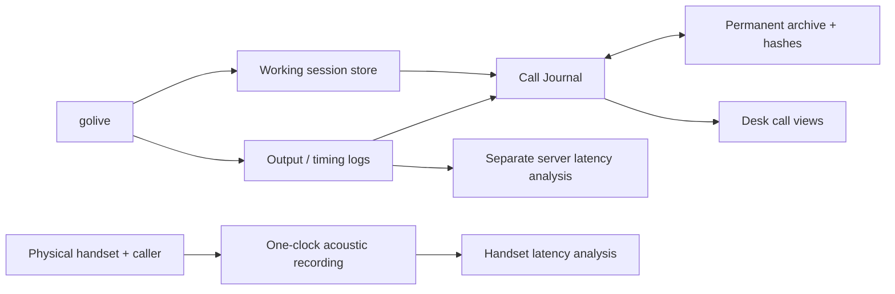

# Recordings, evidence and operations UI

[Architecture index](README.md) · [Interactive explorer](explorer.html)

Source snapshot: `codex/telephony-latency` at `9547d22` · 2026-10-31.

The working store, permanent archive, Call Journal and Desk have different jobs. A server-side WAV proves audio at the application boundary; it cannot prove when the physical handset played that audio. The current target is p95 strictly below 1200 ms, with first audio, content and quotation readout reported separately.

### The three latency answers

| Measure | End boundary | What it establishes |
| --- | --- | --- |
| First audio | First server output audio, including an opener | The application emitted sound |
| First content / quote readout | Answer content or deterministic quote output | The application started the relevant response |
| Physical handset | Audible response at the real phone after caller speech ends | End-to-end telephony experience |

The latest reviewed real call, `out-mvvvt9l4-cauj` on `d85232a`, had 16 measured caller samples: first-audio p95 653 ms and first-content p95 1313 ms at the server boundary. These observations are historical, not a measurement of the later `f842928` release, and do not establish physical handset latency. Sixteen samples also falls short of the strict twenty-sample acceptance minimum.

The target remains p95 strictly below 1200 ms. Do not pool different builds, simulator calls and real calls to manufacture a passing result. Interrupted answers that actually emitted content remain relevant. Missing evidence, ambiguous handoffs and absent output must remain visible.

### Evidence locations and privacy

Working PCM and session metadata live under `~/golive-calls`. Ended-call evidence is retained under `~/golive-archive`; the Journal presents that evidence. Desk reads through to it and stores its own notes/work logs separately under `~/golive-desk`. Repository retrospectives are sanitized explanations; they are not a replacement for the private audio and manifest.

## Components

| Component | Location | Responsibility |
| --- | --- | --- |
| [Working session store](#store) | ~/golive-calls/<session> | Stores raw input/output audio and session metadata while a recorded call runs. |
| [Permanent call archive](#archive) | ~/golive-archive/calls/YYYY/MM | Keeps completed call evidence with file hashes and explicit call/session/build identity. |
| [Call Journal](#journal) | 192.168.71.9:8790 | Lets the owner replay calls and inspect transcripts, latency, quotations, fillers, focus evidence and retrospectives. |
| [Latency + health evidence](#metrics) | /metrics · logs · :8768/ingest | Separates service health, stage timing and the different boundaries of response latency. |
| [Agent Desk](#desk) | Linux box · :8792 | Shows owner/agent coordination, work logs, simulator scenarios/reports and the Talker experiment. |
| [Handset acoustic capture](#capture) | Local browser recorder | Records caller speech and the physical phone's audible answer on one sample clock. |

## Working session store

Stores raw input/output audio and session metadata while a recorded call runs.

**Boundary:** Box / filesystem. **Location:** ~/golive-calls/<session>.

**Receives:** Session audio and lifecycle/history updates.

**Produces:** input.pcm, output.pcm and session.json; stereo recording export after closure.

**Operation:** Recording must be enabled in the running process. The current operational retention setting is 720 hours; the store and permanent archive are different directories.

**Boundary and limitations:** Trimmed model history is not a complete canonical transcript. Files from an open call are not yet a verified permanent archive.

**Implementation and detailed runbooks:** [internal/store/store.go](../../internal/store/store.go), [internal/server/server.go](../../internal/server/server.go), [CALL-OPERATIONS.md](../../CALL-OPERATIONS.md).

## Permanent call archive

Keeps completed call evidence with file hashes and explicit call/session/build identity.

**Boundary:** Box / filesystem. **Location:** ~/golive-archive/calls/YYYY/MM.

**Receives:** Closed session data, service log and the journal's parsed call.

**Produces:** audio.wav, transcript.txt, call.json, session.json, golive.log and manifest.json.

**Operation:** Verify all five evidence files, SHA-256 hashes, both speaker texts and non-silent channels. The WAV is caller-left / assistant-right. Mirroring is a separate operation to an established destination.

**Boundary and limitations:** Permanent on one disk is not an off-machine backup. The recording is at the server boundary, not a microphone at the handset.

**Implementation and detailed runbooks:** [internal/journal/archive.go](../../internal/journal/archive.go), [CALL-OPERATIONS.md](../../CALL-OPERATIONS.md), [TELEPHONY.md](../../TELEPHONY.md).

## Call Journal

Lets the owner replay calls and inspect transcripts, latency, quotations, fillers, focus evidence and retrospectives.

**Boundary:** Box / Go + UI. **Location:** 192.168.71.9:8790.

**Receives:** Service logs, session store, permanent archives and repository issues/retrospectives.

**Produces:** Per-call UI, audio endpoints, latency reports, issue history and Talker reachability status.

**Operation:** cmd/journal indexes ended calls and archives them. Retrospectives/issues are read from files; source updates can refresh notes without restarting an active voice call.

**Boundary and limitations:** A Talker health probe does not prove Talker generated call audio. A recording flag or HTTP audio response alone does not prove a complete archive.

**Implementation and detailed runbooks:** [cmd/journal/main.go](../../cmd/journal/main.go), [internal/journal/server.go](../../internal/journal/server.go), [internal/journal/latency.go](../../internal/journal/latency.go), [internal/journal/fillers.go](../../internal/journal/fillers.go), [internal/journal/talker.go](../../internal/journal/talker.go), [CALL-OPERATIONS.md](../../CALL-OPERATIONS.md).

## Latency + health evidence

Separates service health, stage timing and the different boundaries of response latency.

**Boundary:** Box / measurement. **Location:** /metrics · logs · :8768/ingest.

**Receives:** VAD close, player output, tool-origin relationships and session/process counters.

**Produces:** Prometheus text, structured timing records, console telemetry and strict CLI reports.

**Operation:** scripts/call-latency.sh delegates to the shared analyzer. Report first audio, first content and deterministic quotation readout separately; the strict gate uses p95 <1200 ms and at least 20 valid caller samples.

**Boundary and limitations:** Server timings omit phone transport. A filler can make first audio fast while the answer is late; missing/interrupted evidence must not be silently discarded.

**Implementation and detailed runbooks:** [internal/metrics](../../internal/metrics), [scripts/call_latency.py](../../scripts/call_latency.py), [internal/journal/latency.go](../../internal/journal/latency.go), [TELEPHONY.md](../../TELEPHONY.md), [HANDSET-LATENCY.md](../../HANDSET-LATENCY.md).

## Agent Desk

Shows owner/agent coordination, work logs, simulator scenarios/reports and the Talker experiment.

**Boundary:** Box / Go + UI. **Location:** Linux box · :8792.

**Receives:** Authenticated notes/work-log entries, scenario operations and read-through journal/simulator data.

**Produces:** Checksummed notes, open tasks, live work streams and test pages.

**Operation:** Each participant has a distinct token. The owner controls pause/mode. Desk reads journal recordings rather than maintaining a second independent audio archive.

**Boundary and limitations:** Desk does not itself schedule or launch agents. Its mode switch is not an implemented autonomous deployment scheduler.

**Implementation and detailed runbooks:** [cmd/desk/main.go](../../cmd/desk/main.go), [internal/desk](../../internal/desk), [scripts/desk.sh](../../scripts/desk.sh), [TELEPHONY.md](../../TELEPHONY.md).

## Handset acoustic capture

Records caller speech and the physical phone's audible answer on one sample clock.

**Boundary:** Mac / measurement. **Location:** Local browser recorder.

**Receives:** Mac microphone with the phone on speaker beside it.

**Produces:** WAV, recording metadata and reviewed utterance/answer boundaries.

**Operation:** Use scripts/handset-capture.py and scripts/handset_latency.py as documented in HANDSET-LATENCY.md. Match exported evidence to the exact call ID.

**Boundary and limitations:** Requires an actual suitable recording, not just an active recorder page. The latest analyzed server archive does not establish a below-1200 ms physical handset result.

**Implementation and detailed runbooks:** [HANDSET-LATENCY.md](../../HANDSET-LATENCY.md), [scripts/handset-capture.py](../../scripts/handset-capture.py), [scripts/handset_latency.py](../../scripts/handset_latency.py), [web/handset-capture](../../web/handset-capture).
