# Development, deployment and access

[Architecture index](README.md) · [Interactive explorer](explorer.html)

Source snapshot: `codex/telephony-latency` at `9547d22` · 2026-10-31.

Development runs on the Mac, CI runs on GitHub, and the service runs on the Linux box. runner.sh is the transport and queue for authorized remote commands. CI checks the change; the runner-based release procedure deploys it. The checked workflow does not itself deploy the box.

```mermaid
flowchart LR
  Dev[Mac source / tests] --> GH[GitHub PR]
  GH --> CI[Quality + normal + race]
  CI -->|verified commit| Build[Identifiable release bundle]
  Build --> Runner[Mac runner / SSH]
  Runner --> Idle[Idle check + preserve state]
  Idle --> Box[Replace required box services]
  Box --> Verify[Health / hashes / warming / archive]
  Verify --> Replay[Matched replay + sanitized notes]
```

### Release lifecycle

The repository workflow triggers on pull requests and pushes to `dev`, `master` and `telephony-realtime`. The task branch receives checks through its PR. GitHub Actions runs quality, normal tests and race tests; the workflow contains no direct deployment stage. The agent-operated runner workflow supplies continuous delivery for this setup.

Before replacing a service, establish that the main phone and browser demo are idle. Preserve private environment files, prompt/greeting, voice, business configuration, retained archives and working stores. Retain the actual prior binaries and changed files for rollback. Confirm the running binary's identity after restart rather than relying solely on the bundle's version label.

CRM is an independent long-running process and is not automatically replaced by a normal phone-service restart. Journal metadata changes can be picked up from disk without restarting a call. Restarting components is different from deploying note files.

### Access boundaries

The checked phone profile listens on localhost and disables its own authentication there. Production profiles support session authentication, caps and backpressure. CRM and Desk have token-protected APIs. Journal does not provide its own login. Public tunnel and Access configuration are separate infrastructure, so the documented hostname table is not a current security or DNS audit.

## Components

| Component | Location | Responsibility |
| --- | --- | --- |
| [Mac development workspace](#dev) | Local Git checkout | Hosts source changes, tests, architecture docs and the agent-driven improvement workflow. |
| [runner.sh job bridge](#runner) | ~/golive/runner.sh | Transfers approved artifacts and executes queued shell jobs on the box over SSH. |
| [GitHub repository + PR](#github) | chuanmingliu/full-duplex-go-live | Stores source history and provides the review boundary for changes. |
| [GitHub Actions checks](#ci) | .github/workflows/ci.yml | Checks formatting, correctness, race safety, builds and evidence-parser regressions before release. |
| [Bundle + verified release](#release) | ~/golive-releases · ~/golive-telephony | Ships known binaries and files, switches the running service and retains rollback evidence. |
| [Browser voice demo](#demo) | 127.0.0.1:9080 | Exposes browser microphone conversation through a separate golive process. |
| [Cloudflare access path](#tunnel) | Existing public hostname routing | Routes selected public hostnames to services on the private box. |

## Mac development workspace

Hosts source changes, tests, architecture docs and the agent-driven improvement workflow.

**Boundary:** Mac. **Location:** Local Git checkout.

**Receives:** User instructions, sanitized findings, source and retrieved call evidence.

**Produces:** Reviewed commits, build artifacts and explicit runner jobs.

**Operation:** Current documented branch is codex/telephony-latency at f842928. telephony-realtime is the reference branch. Preserve unrelated work and private call artifacts.

**Boundary and limitations:** The untracked playground directory is not part of the f842928 architecture snapshot and was not modified for these docs.

**Implementation and detailed runbooks:** [README.md](../../README.md), [CALL-OPERATIONS.md](../../CALL-OPERATIONS.md), [.github/workflows/ci.yml](../../.github/workflows/ci.yml).

## runner.sh job bridge

Transfers approved artifacts and executes queued shell jobs on the box over SSH.

**Boundary:** Mac → box. **Location:** ~/golive/runner.sh.

**Receives:** .runner/in/*.job, optional #push/#pull directives and a timeout.

**Produces:** Remote command results in .runner/out and completed jobs in .runner/done.

**Operation:** The persistent Mac loop uses an SSH control connection. Job bodies execute on the box, not on the Mac; jobs are processed serially.

**Boundary and limitations:** It is a transport/queue, not a transaction manager. A timeout or missing receipt is not proof an action never happened, especially for real calls.

**Implementation and detailed runbooks:** [CALL-OPERATIONS.md](../../CALL-OPERATIONS.md), [scripts/phone-brain.sh](../../scripts/phone-brain.sh).

**Separate local source:** `~/golive/runner.sh`; read for this architecture, not part of the Git repository.

## GitHub repository + PR

Stores source history and provides the review boundary for changes.

**Boundary:** External platform. **Location:** chuanmingliu/full-duplex-go-live.

**Receives:** Sanitized source/docs/tests pushed from the development branch.

**Produces:** Commit identities, pull-request diffs and CI runs.

**Operation:** The inspected source snapshot is 30 commits ahead of the previously checked telephony-realtime base. This relationship can change after further pushes.

**Boundary and limitations:** Raw calls, keys, rendered private prompts and phone numbers belong outside GitHub.

**Implementation and detailed runbooks:** [.github/workflows/ci.yml](../../.github/workflows/ci.yml), [CALL-OPERATIONS.md](../../CALL-OPERATIONS.md).

## GitHub Actions checks

Checks formatting, correctness, race safety, builds and evidence-parser regressions before release.

**Boundary:** External platform. **Location:** .github/workflows/ci.yml.

**Receives:** Pull requests, or pushes to dev/master/telephony-realtime.

**Produces:** Quality, normal-test and race-test results attached to a commit.

**Operation:** Quality runs gofmt, go vet, latency/handset tests, build and govulncheck. The Go test matrix runs normal and -race modes with a 25-minute timeout.

**Boundary and limitations:** This workflow contains no box deployment job. A green run is not proof of real provider or handset latency; task-branch CI is reached through its PR trigger.

**Implementation and detailed runbooks:** [.github/workflows/ci.yml](../../.github/workflows/ci.yml), [Makefile](../../Makefile), [TESTING.md](../../TESTING.md).

## Bundle + verified release

Ships known binaries and files, switches the running service and retains rollback evidence.

**Boundary:** Mac build → box. **Location:** ~/golive-releases · ~/golive-telephony.

**Receives:** Reviewed commit, successful checks, clean build provenance and a file/hash manifest.

**Produces:** Installed phone/CRM/journal binaries, observed runtime identities and release receipts.

**Operation:** Require main and demo idle; preserve settings, prompt, credentials, recording and archives; verify health, versions, hashes and warm-up. CRM replacement is explicit. Re-run a matched scenario after deployment.

**Boundary and limitations:** Build-time VERSION and the running executable can differ. Unknown process state is not safe idle state; an ordinary phone restart does not automatically replace CRM.

**Implementation and detailed runbooks:** [CALL-OPERATIONS.md](../../CALL-OPERATIONS.md), [scripts/phone-brain.sh](../../scripts/phone-brain.sh), [Makefile](../../Makefile).

## Browser voice demo

Exposes browser microphone conversation through a separate golive process.

**Boundary:** Box / Go + UI. **Location:** 127.0.0.1:9080.

**Receives:** Browser WebSocket/audio using the browser profile.

**Produces:** Streaming speech and the interactive demo UI.

**Operation:** Started by phone-brain.sh demo on. It shares provider accounts with the phone service but has its own listener, log and session pool.

**Boundary and limitations:** The documented deployment disables its recording and telephony telemetry. It does not exercise the GSM/PBX/handset path and can compete for provider capacity.

**Implementation and detailed runbooks:** [TELEPHONY.md](../../TELEPHONY.md), [scripts/phone-brain.sh](../../scripts/phone-brain.sh), [configs/tencent-deepseek-minimax.json](../../configs/tencent-deepseek-minimax.json), [web](../../web).

## Cloudflare access path

Routes selected public hostnames to services on the private box.

**Boundary:** External + box tunnel. **Location:** Existing public hostname routing.

**Receives:** Browser requests to configured hostnames.

**Produces:** Requests to Aria, the browser demo, Journal or other existing upstreams.

**Operation:** TELEPHONY.md documents golive. → :9080 and robotgo. → LAN :8790. Tunnel/DNS/Access policy are maintained outside this Go application.

**Boundary and limitations:** These are documented routes, not a fresh DNS or Access audit. Journal has no built-in login; exposure controls must be considered at the actual access layer.

**Implementation and detailed runbooks:** [TELEPHONY.md](../../TELEPHONY.md), [README.md](../../README.md).
