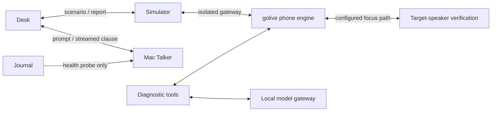

# Simulator, Talker and local model lab

[Architecture index](README.md) · [Interactive explorer](explorer.html)

Source snapshot: `codex/telephony-latency` at `9547d22` · 2026-10-31.

These tools exercise or extend the main system. They must be distinguished from the configured phone path: the simulator is a separate customer service, Talker is a separately served first-clause experiment, and the edge gateway offers local model alternatives.

### How to interpret each test

| Tool | Exercises | Does not prove |
| --- | --- | --- |
| Unit/race tests | Logic, concurrency and regressions | Provider performance or telephone quality |
| Provider probes | A model/synthesizer boundary | Complete conversational experience |
| Loopback benchmark | Application/provider pipeline | Carrier and handset transport |
| Synthetic customer | Repeatable conversation and media integration | Human handset audio arrival |
| Real call + acoustic capture | Actual phone experience | Sustained p95 without enough valid samples |

Talker is served on the Mac and tested through Desk. Its health endpoint and playground integration are present, but there is no established Talker inference path in the inspected phone engine. The local edge gateway is another experimentation surface. The target-speaker verification service is the local model endpoint specifically selected by the phone profile.

## Components

| Component | Location | Responsibility |
| --- | --- | --- |
| [Synthetic customer + gateway](#simulator) | Receiver :18865 · isolated SIP gateway | Answers as a repeatable synthetic customer and tests conversation behaviour without calling the owner's handset. |
| [Local Talker experiment](#talker) | Documented :18081 via llama-server | Generates a short first clause from conversation context, the caller's words and an already chosen opener. |
| [Local speech model lab](#edge) | Gateway :8030 · model runtimes | Offers self-hosted recognition, synthesis and diarization alternatives through familiar API shapes. |
| [Benchmarks + diagnostic tools](#probes) | CLI commands and test suites | Isolates model, synthesis, turn-taking and protocol behaviour before a costly live-call test. |

## Synthetic customer + gateway

Answers as a repeatable synthetic customer and tests conversation behaviour without calling the owner's handset.

**Boundary:** Box / separate service. **Location:** Receiver :18865 · isolated SIP gateway.

**Receives:** Reserved scenario/run ID followed by a call to that run's SIP target.

**Produces:** Customer speech, event history, assertions and an independent receiver report.

**Operation:** Maintained on codex/inbound-user-simulator, with golive-simulator and golive-simctl. The gateway uses its own network/endpoint; call sim invokes this route, not the configured real number.

**Boundary and limitations:** Simulator receiver observations are not handset measurements. The receiver does not retain its own audio; the assistant-side Journal/archive supplies recordings when enabled.

**Implementation and detailed runbooks:** [TELEPHONY.md](../../TELEPHONY.md), [scripts/sim-bundle.sh](../../scripts/sim-bundle.sh), [scripts/sim-retro.py](../../scripts/sim-retro.py).

## Local Talker experiment

Generates a short first clause from conversation context, the caller's words and an already chosen opener.

**Boundary:** Mac / model service. **Location:** Documented :18081 via llama-server.

**Receives:** Desk-rendered prompt matching the local Qwen3-0.6B fine-tuning contract.

**Produces:** Streamed clause plus first-token/clause/total timings and a rule-based verdict.

**Operation:** Desk #/talker invokes it and records numeric attempts in talker-web. Journal probes /v1/models for reachability and links to the experiment.

**Boundary and limitations:** No runtime path from the checked duplex engine to this Talker is established. The phone's phrase-cache openers remain separate. Health is a point-in-time probe, not per-call provenance.

**Implementation and detailed runbooks:** [internal/desk/talker.go](../../internal/desk/talker.go), [internal/journal/talker.go](../../internal/journal/talker.go), [scripts/phone-brain.sh](../../scripts/phone-brain.sh), [TELEPHONY.md](../../TELEPHONY.md).

## Local speech model lab

Offers self-hosted recognition, synthesis and diarization alternatives through familiar API shapes.

**Boundary:** Box / Go + Python. **Location:** Gateway :8030 · model runtimes.

**Receives:** Audio transcription requests, text-to-speech requests or diarization streams.

**Produces:** Normalized text/audio/speaker events from the selected local model.

**Operation:** EDGE.md describes Audio8 ASR/TTS and Nemotron diarization. Per-model slots bound CPU contention. The phone profile instead references the direct :8032 target-speaker service for focus.

**Boundary and limitations:** These are documented lab options, not the configured main ASR/TTS providers. Runtime availability and model-specific licensing need separate checks before adopting them.

**Implementation and detailed runbooks:** [EDGE.md](../../EDGE.md), [cmd/edge/main.go](../../cmd/edge/main.go), [internal/edge](../../internal/edge), [edge](../../edge).

## Benchmarks + diagnostic tools

Isolates model, synthesis, turn-taking and protocol behaviour before a costly live-call test.

**Boundary:** Mac / box tooling. **Location:** CLI commands and test suites.

**Receives:** Fixed scenarios, phrases, recorded clips or mock/real providers.

**Produces:** Timing tables, comparison reports, diagnostic audio and regression results.

**Operation:** Commands include golivebench, golivefdb, goliveturn, llmprobe, ttsprobe, echoprobe and golivectl. Use TESTING.md, BENCHMARK.md and FULLDUPLEX-BENCH.md for the intended scope.

**Boundary and limitations:** Loopback and synthetic measurements answer narrower questions than a real phone call. Keep their populations and timing boundaries separate.

**Implementation and detailed runbooks:** [TESTING.md](../../TESTING.md), [BENCHMARK.md](../../BENCHMARK.md), [FULLDUPLEX-BENCH.md](../../FULLDUPLEX-BENCH.md), [cmd](../../cmd).
