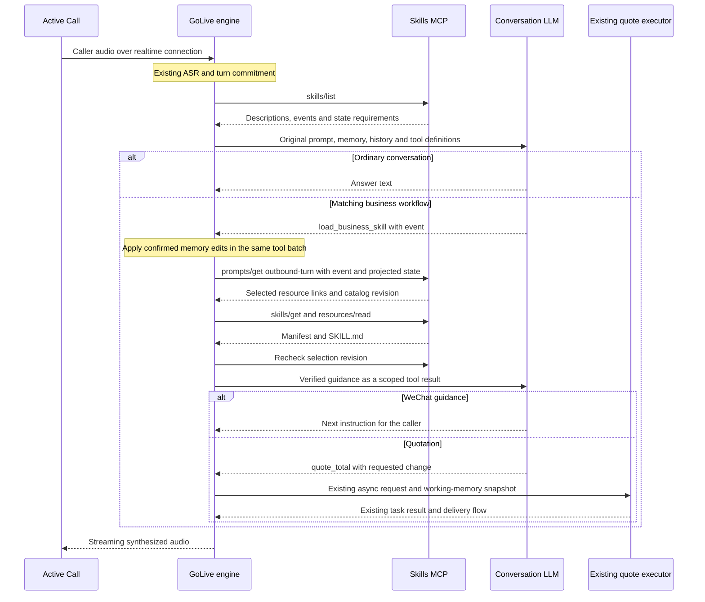

# Active Call prompt rendering with skills over MCP

This guide describes the opt-in implementation on `codex/telephony-latency`, tested on 8 November 2026. The ThinkPad catalog runs release `0bd39794` with catalog revision 5. The live phone engine remains on its existing configuration. Activation of this integration requires an engine build containing these changes and the additive settings below.

## Prompt composition

Active Call sends the session's configured instructions to the GoLive realtime endpoint. The existing CRM/Jinja rendering supplies the business prompt. GoLive builds the following components for each backend completion.

| Component | Source | Lifetime and role |
| --- | --- | --- |
| Original conversation prompt | Saved session instructions, produced by the existing configuration flow | Keeps the existing normalization and stable prefix in `systemPrompt`. |
| Backend instructions | Session backend configuration | Existing business and delegation instructions. |
| Host tool policy | `InstructionsAppend` and existing tool setup | Execution rules and locally permitted actions. |
| Working memory | Engine-owned versioned JSON | Latest confirmed facts and tool results, appended by the existing memory renderer. |
| Conversation | Engine history and current user transcript | Preserves native assistant/tool-call pairing and opener coordination. |
| Skill discovery | Authenticated `skills/list` | Descriptions, event names and state requirements in the `load_business_skill` function definition. No skill body is included at discovery. |
| Retrieval policy | Host-authored system message | Requests current guidance for matching workflows and original-prompt fallback on failure. |
| Loaded guidance | A `load_business_skill` tool result | Verified Markdown body, source URI, digest, caller-turn scope and memory version. |
| Executable functions | Existing host tool definitions | Existing quotation, memory and hangup handlers retain their execution contracts. |

The implementation lives in [prompt assembly](../../internal/duplex/think.go), [engine skill integration](../../internal/duplex/skills.go), [tool scheduling](../../internal/duplex/tools.go) and the [MCP client](../../internal/skillsmcp/client.go).

## A turn from speech to answer



Discovery and retrieval run on workers outside the audio loop. Each discovery has a 150 ms default deadline. A complete load, including selection, all file reads and revision recheck, shares another 150 ms deadline. A turn can contain several model completions, each with discovery. The total turn therefore has additional model and discovery costs beyond one retrieval deadline.

## Semantic routing and deterministic conditions

The conversation LLM chooses an event from the published tool schema using the caller's meaning. The engine adds no keyword classifier. The MCP service then matches the supplied event exactly and requires every configured state condition to match. This gives operators control over availability while leaving natural-language interpretation with the conversation model.

| Situation | Event and state | Selected instructions |
| --- | --- | --- |
| Caller asks a general question | No business-tool call needed | Existing conversation prompt |
| Caller requests an initial price | `quote.requested` | Motor quotation workflow |
| Caller changes coverage in this call | `quote.revised` | Preserve the base plan, apply the requested change and calculate again |
| Caller wants alternatives | `quote.compare` | Compare alternatives relative to the confirmed plan |
| Caller agrees to add the WeChat service | `wechat.add_requested`, `wechat.status=consented` | WeChat service-notification guidance |
| Caller cannot find the notification | `wechat.notification_help`, status `consented` or `awaiting_confirmation` | Step-by-step screen guidance |
| Caller declines, has completed the step, or has no recorded consent | WeChat state fails the configured guard | Original prompt fallback |

The runtime sends only explicitly allowed state paths. The default projection contains `wechat.status`. The model can use the existing `update_memory` tool for facts the caller confirms. In a batch containing a memory edit and a skill load, the engine applies memory edits before capturing the selection snapshot.

Consent recorded from conversation is model-maintained state. Delivery receipts and confirmed external operation status still need an authoritative CRM callback integration. The current WeChat skill provides instructions. It does not send a notification, add a contact or prove delivery.

## Quotation execution

The catalog also exposes `quote_total` as a standalone MCP business tool. This prompt integration retains Active Call's existing native quotation executor, which already handles asynchronous tasks, snapshots, acknowledgments and prepared result delivery. The model receives workflow guidance through MCP and invokes the existing locally registered quotation function.

MCP tool descriptions and tool bindings do not dynamically register new executable functions inside GoLive. Adding a new execution backend requires a reviewed host binding. This prevents a catalog edit from silently replacing the established task lifecycle.

Quotation calculation remains a separate timing category. A fast acknowledgment can precede the configured calculation delay, and the eventual result follows the current delivery flow. Preserve confirmed plan fields when only one coverage item changes.

## Freshness, interruption and fallback

Each loaded tool result carries the originating caller-turn scope and memory version. A continuation of that turn inherits its scope. Before composing another request, the renderer replaces older-scope or older-memory guidance with an expired marker while preserving function-call/result pairing. It leaves the retained canonical history intact.

The client checks the selected URI, resource count, byte length, SHA-256 and generated frontmatter against the manifest. It rechecks the catalog revision after reading the files. A concurrent publication produces fallback for that load. A later request discovers the published version. The client supports the maintained service's generated SKILL.md format with two JSON-quoted YAML fields.

Missing credentials disable the optional integration at engine initialization. Unavailable discovery leaves the request on the existing prompt/tool path. Timeout, malformed resources, digest mismatch and revision mismatch yield an unavailable result with the original-prompt instruction. A valid empty selection yields `no_match`.

Retrieval uses the session context and a bounded deadline. Interruption prevents its late result from restarting the abandoned answer by tracking the pending skill work as part of the assistant’s turn and discarding its result when that generation is invalidated. An in-flight HTTP load can continue until its deadline. The added regression test verifies that delayed retrieval cannot resume speech after interruption.

Operators can edit descriptions, event rules, state guards and Markdown in the [catalog panel](../../services/skills-mcp/README.md). A subsequent completion fetches the current catalog, and a subsequent matching load reads current instructions. Existing spoken audio and already submitted business actions keep their original execution context.

## Configuration and activation

Add this component to a candidate profile while retaining the original configuration file as the restore source.

```json
{
  "tools_memory": true,
  "skills_mcp": {
    "url": "http://127.0.0.1:8794/mcp",
    "token_file": "/home/chuanming/golive-skills-mcp/secrets/runtime",
    "timeout_ms": 150,
    "state_keys": ["wechat.status"]
  }
}
```

`GOLIVE_SKILLS_MCP_URL` and `GOLIVE_SKILLS_MCP_TOKEN_FILE` override the corresponding fields. An empty URL disables integration. The client accepts HTTPS and loopback HTTP, rejects redirects and reads the runtime credential privately. Keep the administrative credential in the operator panel's access path.

The catalog is already deployed on the ThinkPad. The production phone engine has not been activated with these settings. Initial engine activation needs the usual idle-only deployment and health/configuration verification. Later catalog content publications take effect without restarting an enabled engine. Configuration changes such as the endpoint, token path and state allowlist require an engine restart.

## Simulation results

The comparison used the actual engine's text entry and output-event paths plus the deployed ThinkPad MCP service. Each scenario ran 20 baseline and 20 enabled iterations, for 120 trials. The baseline used an empty skills URL. Both modes used a scripted 120 ms-per-completion LLM and mock synthesis. Relevant candidate turns were required to receive a successfully loaded skill in their model continuation.

| Scenario | Baseline p50 / p95 | Enabled p50 / p95 | p95 increase |
| --- | --- | --- | --- |
| Ordinary response | 120.926 / 121.246 ms | 121.871 / 122.300 ms | 1.054 ms |
| Revised quotation acknowledgment | 120.893 / 121.347 ms | 245.669 / 246.430 ms | 125.083 ms |
| WeChat notification guidance | 120.978 / 121.265 ms | 245.811 / 246.518 ms | 125.253 ms |

The first-content boundary is the first emitted audio event from mock synthesis. It excludes ASR, real synthesis, Active Call/RustPBX transport and handset playout. The normal scenario used one model completion. Matching workflows used an extra completion after retrieval, accounting for 120 ms of their controlled increase. The test does not measure the longer prompt's real-model token-processing cost.

A separate synthetic quotation completion test retained a 3-second calculation delay. Measured executor durations were 3000.760 ms baseline and 3001.150 ms enabled. Both emitted a delivered task. The simulation also checked that the native quote request retained the existing plan and the new coverage amount. The live quotation service's configured delay was unchanged.

The deployed service smoke test verified authentication boundaries, manifests, workflow selection, a synthetic CRM `need` result and no-match behavior after WeChat completion. Local regressions cover prompt preservation, expiry, timeout fallback, changed content, publication races and interrupted retrieval. The [machine-readable comparison](../telephony/evidence/2026-11-08-skills-prompt/comparison.json) records the measurement boundary and results.

Automatic approval review rejected an additional real-model probe because it would transmit the saved private prompt to the external model. Semantic event selection by that model remains unverified. The controlled results establish integration behavior and isolate overhead, with real-provider acceptance still required before phone activation.

### Reproduce the controlled comparison

Run the default regression suite from the repository root.

```sh
go test -race ./internal/duplex -run '^TestSkills' -timeout 45s
```

Build the same test binary for the ThinkPad, transfer it using a reviewed runner job, then execute it on the box with its runtime token path.

```sh
CGO_ENABLED=0 GOOS=linux GOARCH=amd64 go test -c ./internal/duplex -o /tmp/duplex.test
```

```sh
SKILLS_SIM_URL=http://127.0.0.1:8794/mcp \
SKILLS_SIM_TOKEN_FILE="$HOME/golive-skills-mcp/secrets/runtime" \
./duplex.test -test.run '^TestSkillsBoxLatencySimulation$' -test.v -test.timeout 150s
```

## Integration roadmap

| Stage | Work and exit condition | Status |
| --- | --- | --- |
| 1. Catalog and publishing | Authenticated MCP discovery/read, quotation adapter, panel, versioned atomic publication and persistent Compose deployment | Implemented and smoke-tested on ThinkPad |
| 2. Prompt composition | Preserve original components, add metadata discovery, lazy skill retrieval, source/integrity checks and fallback | Implemented behind optional configuration |
| 3. Session consistency | Scope guidance to caller turn and memory version, preserve tool pairing, reject inconsistent publication and suppress interrupted continuation | Implemented with regressions |
| 4. Controlled latency acceptance | Quotation and WeChat A/B trials, no-match cases, calculation timing reported separately | Completed with the measurements above |
| 5. Real-model acceptance | Use approved synthetic business prompts and histories with the configured provider. Check event choice, no consent inference from general questions, revision semantics and absence of repeated loader loops. Compare first content and token usage across repeated trials | Pending |
| 6. Full media simulation | Run original ASR/model/TTS and Active Call transport in isolated baseline/candidate sessions. Exercise interruption during discovery, guidance and quote calculation, plus echo/background rejection | Pending |
| 7. Authoritative business state | Map CRM and WeChat receipts to versioned session facts. Add operation IDs, idempotent processing, stale-callback rejection and opt-out precedence. Keep allowed state projections explicit | Pending |
| 8. Deployment and real-call acceptance | Deploy the enabled engine only when idle, preserve the original profile/build, verify Journal chat and both audio directions, then measure normal responses and interruptions on a consented test call | Pending |
| 9. Broader workflows | Add domain events, skills and reviewed execution bindings. Evaluate moving the native quotation transport to MCP while retaining existing task, memory-version and acknowledgment semantics | Pending |
| 10. Operational tuning | Record selected skill/revision, fallback reasons and retrieval timing without prompt/credential logging. Evaluate revision-aware caching and safe prefetch after real-model latency establishes their value | Pending |

For stage 5, include initial quotation, one-field revision, multiple alternatives, missing intake, caller opt-out, missing WeChat consent, notification search, successful completion, a catalog edit between user turns and service loss during retrieval. Require factual plan preservation and no unintended business action. For stages 6–8, continue reporting normal first-content latency and interruption cut-off separately from quotation completion, and distinguish server timing from handset measurements.
