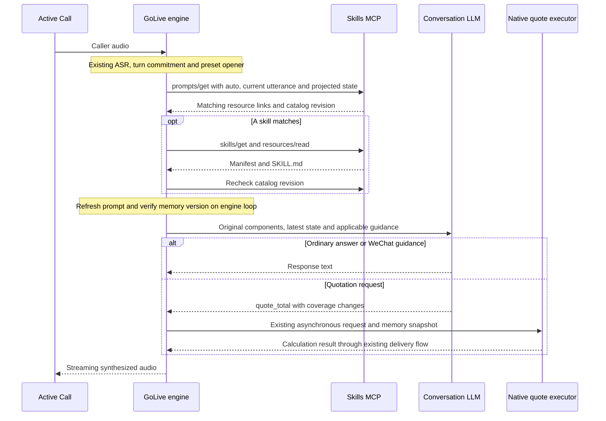

# Active Call prompt rendering with skills over MCP

The `codex/telephony-latency` integration composes the original GoLive prompt with current business state and operator-published skills. The November 9 revision moves skill selection before the first model completion and adds authoritative WeChat completion handling. The live phone profile remains the deployment restore source. Activation uses a candidate profile and an idle-only engine deployment.

## Prompt composition

Active Call supplies its configured instructions to GoLive. Existing CRM/Jinja rendering produces the original business component. Each backend request then assembles these components.

| Component | Owner | Behavior |
| --- | --- | --- |
| Original conversation prompt | Saved session configuration and CRM/Jinja | Existing normalization, stable prefix and preset opener coordination |
| Backend instructions | Session backend configuration | Existing delegation and business instructions |
| Tool policy and executable tools | Host | Existing quotation, memory and hangup handlers |
| Working memory | Engine | Versioned confirmed facts and tool results |
| Conversation | Engine | Spoken history and explicit latest intent after interruption |
| Business-state constraints | Engine | Completed or declined WeChat state applies during fallback too |
| Selected skill guidance | MCP service | Verified Markdown for the current request and state snapshot |
| Retrieval fallback | Engine | Use steps present in the original prompt and ask for missing information |

The implementation is in [prompt assembly](../../internal/duplex/think.go), [skill preparation](../../internal/duplex/skills.go), [business events](../../internal/duplex/business_events.go) and the [MCP client](../../internal/skillsmcp/client.go).

## A turn from speech to answer



Selection and verified retrieval share one deadline, defaulting to 150 ms. Network work runs on a generation worker. The audio loop only snapshots state and assembles messages. Ordinary no-match turns need one MCP request. Matching turns additionally verify the manifest, file bytes, frontmatter and catalog revision. The first model completion already has the selected guidance. Existing legacy skill-tool history remains readable and expires at its original scope boundaries.

## Server-maintained routing

The service accepts explicit normalized events, or `event=auto` with the latest user utterance. Automatic selection uses operator-maintained regular expressions and confirmed state. The conversation model interprets the request and generates the response after this selection.

Each skill has these routing fields.

| Field | Rule |
| --- | --- |
| `events` | Explicit event names eligible for the skill |
| `match` | Automatic selection requires at least one expression to match |
| `exclude` | Any matching exclusion suppresses automatic selection |
| `state` | Every field must equal one of its allowed values |
| `tool` | Optional executable-tool dependency, such as enabled `quote_total` |

The panel edits these fields alongside Markdown. Its preview accepts an utterance with event `auto`. Schema 3 migrates the known quotation and WeChat seeds with initial text rules while preserving operator instructions, enabled flags, events and state guards. Custom skills receive operator-configured patterns. The client requires the service's `auto_selection` capability marker and uses fallback with older services.

Initial quotation patterns cover requested prices, recalculation, revisions and comparisons. Educational questions and explicit refusals avoid loading quotation guidance. WeChat guidance requires `wechat.status=consented` or `awaiting_confirmation`. `added`, `declined` and unknown consent suppress that skill. Ambiguous requests use the original prompt and clarification. Operator patterns can be expanded from observed language without an engine restart.

Selection sends the current utterance and allowlisted state fields to the configured internal MCP endpoint. The default state projection contains `wechat.status`. The full original prompt and full working memory remain with the engine. A new completion retrieves current published instructions, including after a confirmed memory update.

## Interruption recovery

The engine preserves unanswered caller fragments in stored history. After an interruption, prompt rendering gives the latest request its own user message, with prior unfinished context before a system boundary. The boundary allows clarifications and references to use that context while pausing independent old tasks. This preserves a caller's “下一步呢？” continuation and prevents a changed question from reviving the old workflow. Automatic selection uses the newest input. Cancellation and generation checks prevent an interrupted retrieval from restarting output.

Generation cancellation stops pending retrieval through its context. Old generation output remains subject to the existing playback checks. Tool-call/result pairing and already submitted native tasks retain their normal lifecycle. Echo, background-speaker rejection, backchannel decisions and preset opener selection retain their existing implementation.

## Authoritative `addV`

A backend forwards successful WeChat addition to the matching session through its existing authenticated connection or sideband.

```json
{"type":"golive.business.event","name":"addV","event_id":"backend-trace-id"}
```

Both the GoLive session protocol and Realtime input adapter accept this extension. The session invokes `Engine.ApplyBusinessEvent("addV")`. The handler patches `wechat.status` to `added` and emits the versioned `golive.memory` update on the GoLive session/sideband event stream. Duplicate delivery leaves the memory version unchanged. The receiving WebSocket determines the session, so the producer must correlate the backend trace to the correct session before forwarding it.

Only trusted backend events or trusted initial memory establish completed state. A model `update_memory` call cannot manufacture `added` or reverse an established completion, including by deleting or replacing the WeChat object. The model can still record confirmed consent.

A completion arriving during retrieval invalidates the old state snapshot. A completion arriving during an active WeChat answer cancels that generation and replans using completed state. The prompt explicitly acknowledges success and closes the add-account instructions. An idle session records the completion for the next answer. When completion arrives during native `quote_total` calculation, quote validity compares memory snapshots while ignoring only `wechat.status`. Changes to coverage, customer fields or other WeChat fields still invalidate the old result. This avoids requesting another calculation solely because the account was added. The external business producer's forwarding connection remains an integration step; the simulation injects a synthetic event through the same engine method, and a WebSocket regression covers the session adapter.

## Quotation execution

The catalog exposes a standalone MCP `quote_total` tool. Active Call continues to use its native quotation executor, with existing asynchronous tasks, acknowledgments, memory snapshots and result delivery. Skill content describes how to use that host capability. New executable functions require host bindings.

Report quotation submission, acknowledgment, calculation and result completion separately. Synthetic tests use a three-second executor. Live quotation delay comes from the original configuration. A one-field revision retains the other confirmed coverage items.

## Freshness and fallback

Selected guidance carries its source URI, digest, caller scope and memory version. The worker checks publication consistency. Immediately before completion, the engine refreshes the prompt and discards guidance whose memory snapshot changed. Completed and declined state constraints remain present during service failure.

Timeout, unsupported auto-selection, malformed content, digest mismatch and publication races use the original prompt. A no-match turn uses the original components directly. The service's credentials are read privately, redirects are rejected, and configuration permits HTTPS or loopback HTTP.

## Candidate configuration

```json
{
  "tools_memory": true,
  "skills_mcp": {
    "url": "http://127.0.0.1:8794/mcp",
    "token_file": "/home/chuanming/golive-skills-mcp/secrets/runtime",
    "timeout_ms": 150,
    "state_keys": ["wechat.status"]
  }
}
```

`GOLIVE_SKILLS_MCP_URL` and `GOLIVE_SKILLS_MCP_TOKEN_FILE` override the corresponding fields. An empty URL disables optional retrieval. The original configuration remains the rollback source. Preserve the catalog snapshot before upgrading to schema 3, since older service releases require a compatible catalog during rollback. Engine activation and endpoint changes require a restart. Later skill-content and routing publications apply on the next request.

## Validation and deployment roadmap

| Stage | Status and next boundary |
| --- | --- |
| Catalog and panel | Authenticated discovery, verified reads, atomic publishing, routing editor and schema migration implemented |
| Prompt composition | Original component, pre-completion guidance, current state and bounded fallback implemented |
| Session consistency | Latest-intent recovery, state-version expiry and idempotent `addV` adapter implemented |
| Real-model synthetic comparison | 20-pair benchmark and final-code scenario/state/edge confirmation completed; see the follow-up report |
| Full media simulation | Exercise actual ASR/TTS and Active Call transport, including echo and background voice cases |
| Backend forwarding | Correlate actual `addV` traces to authenticated session connections and verify delivery |
| Live activation | Deploy the paired catalog/engine candidate when idle, retain original profile and verify Journal chat and both audio directions |
| Real-call acceptance | Compare normal responses and interruptions, with quotation time and handset measurements reported separately |
| Additional workflows | Add server-maintained patterns, state conditions and skills, with reviewed host bindings for new executable tools |

The [historical real-model report](../telephony/2026-11-09-skills-real-model.md) preserves the original sequential-loading measurements and failures. Its reproduction section identifies the synthetic model harness. These measurements cover text input through mock-TTS output; full telephony and acoustic handset timing require the media and real-call stages above.

The [routing and recovery follow-up](../telephony/2026-11-09-skills-fixes.md) reports the updated latency comparison, final-code checks and remaining timing gaps.
