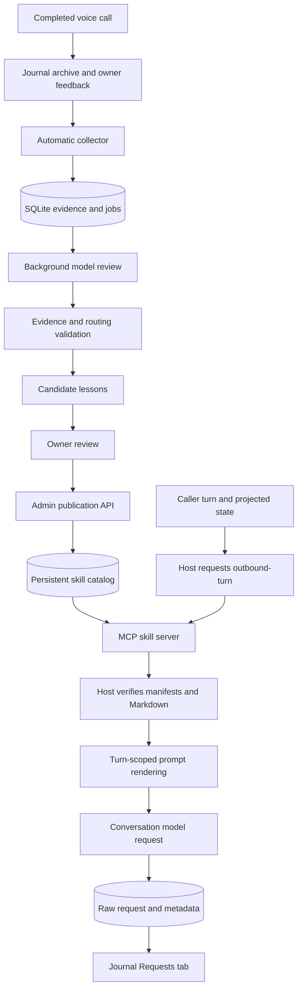
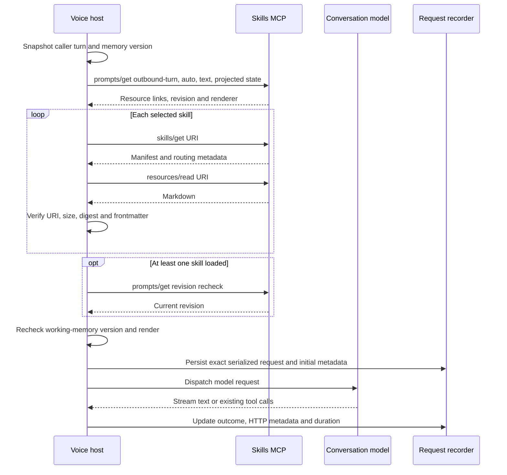

# Skill lifecycle and dreaming memory

This walkthrough follows a reusable lesson from a completed voice call through
review, catalog publication, MCP retrieval, prompt injection and saved requests.
It also describes the business skills that share this mechanism.

## Run the local demonstration

From the repository root, with Python 3 and Go 1.26.11 available, run

```sh
python3 scripts/demos/skill-mechanism.py
# Include concurrency checks when needed.
python3 scripts/demos/skill-mechanism.py --race
```

The runner uses existing integration fixtures and production components. The
reviewer and conversation provider are local HTTP stubs with deterministic
responses. Evidence, credentials and conversation content are synthetic. Storage
uses temporary directories and HTTP servers use loopback ephemeral ports. The Go
toolchain may download dependencies on the first run.

The four stages run independent fixtures. The publication stage prints the actual
candidate ID, published revision, retrieved Markdown and verified digest. The
recording stage prints the session/turn/response relationship and verified byte
count. Passing checks establish the local protocol and component behavior.
Live speech quality and the usefulness of a proposed lesson require separate call
evaluation.

| Stage | Components exercised | Observable result |
| --- | --- | --- |
| Capture and scheduling | SQLite, archive-source fixture, activity monitor, cron | Busy/idle deferral, capture, queued work and restart recovery pass |
| Dream to published skill | Admin HTTP API, model adapter, validation, catalog, MCP server | Candidate stays private until fixture approval; matching retrieval verifies Markdown and digest |
| Host and recording | MCP client, voice engine, v1/v2 renderers, HTTP provider, recorder | Prompt composition, fallback, interruption, state freshness and exact saved bytes pass |
| Journal | Request-store HTTP handlers | Session lookup returns saved body and metadata; integrity changes are detected |

The exact test names are listed in the [demo runner](../../scripts/demos/skill-mechanism.py).

## Deployment snapshot

Read-only inspection on **2026-11-13, approximately 09:40 Asia/Shanghai** found
these settings. This table is a dated deployment observation.

| Item | Observed value |
| --- | --- |
| Main and demo voice engine build | `3970624` |
| Skills service image | `xiaocui-skills:automatic-381fa89-20261112` |
| MCP endpoint on the Box | `http://127.0.0.1:8794/mcp` |
| Catalog revision / selected renderer | `13` / `1` |
| Enabled skills | `motor-quotation`, `wechat-service-notification`, `vehicle_insurance_concepts`, one `memory-…` skill |
| Dreaming reviewer | `deepseek-chat` at the configured DeepSeek chat-completions endpoint |
| Automatic review | Enabled after hangup; 30 seconds idle; simulator calls included |
| Engines monitored for idle | Main `8765` and demo `9080` |
| Cron tasks | Empty task list |
| Saved lessons | One published; seven candidates |
| Demo engine skill integration | Explicitly disabled by its process environment |

The published memory came from the synthetic single-question review. It applies
when the caller requests one question at a time or asks the agent to wait for an
answer. One later review failed because a proposed routing regex remained invalid;
that job produced zero candidate lessons.

## Architecture and storage



| State | Location in the observed deployment | Owner |
| --- | --- | --- |
| Completed-call artifacts | `~/golive-archive` | Journal |
| Evidence, feedback, review jobs, candidates and scheduler state | `~/golive-skills-mcp/data/memory/experiences.sqlite` | Dreaming store |
| Published instruction bodies, routing and renderer setting | `~/golive-skills-mcp/data/catalog.json` | Skills catalog |
| Confirmed business state and its version | Voice-engine call memory | Engine |
| Selected instruction text | Current model-request snapshot | Host renderer |
| Exact model request and related metadata | `~/golive-request-records/<sessionid>/<requestid>/` | Request recorder |

Inside the skills container, the persistent data directory is mounted at `/data`.
The service exposes runtime `/mcp` and administrative `/admin/...` endpoints with
separate bearer credentials. Journal proxies a fixed subset of administrative
operations and holds its credential server-side.

## From a completed call to a candidate

1. The collector polls Journal every five seconds for eligible completed calls.
   It waits for ready archived evidence and records capture outcomes durably.
2. After-hangup or due cron tasks queue an immutable evidence snapshot. Automatic
   capture releases the call under the configured automatic-review policy.
   Manually imported real-call evidence uses the explicit release endpoint.
3. The worker waits for the configured continuous idle period across all monitored
   engines. A new call or unknown engine health defers work. An interrupted review
   returns to pending.
4. The model reviews projected text, timing/tool evidence and captured owner
   feedback. Its request omits local audio paths and original archive JSON.
5. Each proposed lesson includes an observation, reusable procedure, evidence
   references, `match`/`exclude` regex arrays and positive/negative retrieval cases.
6. Validation checks bounded fields, known evidence IDs, regex syntax and expected
   retrieval results. One repair request is allowed within the review deadline.
7. Validated lessons and completed status commit in a SQLite transaction. Failed
   jobs expose a failure category and can be retried explicitly.

Candidate IDs are deterministically derived from the dream ID and proposal index.
The model is instructed to generate procedural guidance with applicability and
exceptions. Human review assesses factual support and behavioral usefulness.

The implementation lives in [automatic.go](../../services/skills-mcp/internal/dreaming/automatic.go),
[worker.go](../../services/skills-mcp/internal/dreaming/worker.go),
[model.go](../../services/skills-mcp/internal/dreaming/model.go) and
[types.go](../../services/skills-mcp/internal/dreaming/types.go).

## Owner review and publication

The Dreaming tab shows job events, linked calls, observations, lesson text,
evidence references, routing cases and publication status. Its current controls
configure scheduling and retry failed jobs. **Approval/publication currently uses
the admin API.** The catalog editor can edit or disable a published skill.

Review the source call and proposed lesson together. Check whether the evidence
supports the diagnosis, the procedure preserves business rules, the applicability
and exceptions are clear, and matching examples represent the intended scenarios.

The following is an API walkthrough with placeholders. Box operations use the
existing runner described in [CALL-OPERATIONS.md](../../CALL-OPERATIONS.md).
Credentials stay in local secret files.

```http
GET /admin/memory/lessons
GET /admin/memory/dreams/{dream_id}
GET /admin/catalog
POST /admin/memory/lessons/{lesson_id}/publish
Content-Type: application/json
Authorization: Bearer <admin credential>

{
  "revision": 13,
  "reviewed": true,
  "allow_simulation_evidence": false
}
```

Use the revision from the immediately preceding catalog read. A simulation-derived
lesson needs `allow_simulation_evidence: true` after review of that evidence.
The local demo simulates this approval boundary with fixture data.

Publication revalidates the saved proposal and creates a catalog entry with
`name = lesson ID`, `description = title`, `enabled = true`, event
`memory.recalled`, the reviewed lesson body, and its inclusion/exclusion rules.
The body includes applicability guidance and the precedence of current user input,
host instructions and authoritative tool results.

The catalog increments its revision, writes a temporary file, syncs it, atomically
renames it, then swaps the in-memory MCP server under a lock. Subsequent stateless
MCP requests see the new catalog. Startup rebuilds registrations from that file.

An identical publish retry succeeds. A stale revision returns 409. A retry against
an edited or disabled entry also returns 409. Catalog contents determine actual
publication state; recording the associated SQLite publication event is best effort.
The response includes the published revision and `skill://.../SKILL.md` URI.

The approval record currently consists of admin authorization, the `reviewed`
acknowledgement and the publication event/catalog state. Dedicated reviewer
identity, review comments and an evaluation score are future work.

See [memory.go](../../services/skills-mcp/memory.go) and
[catalog.go](../../services/skills-mcp/catalog.go).

## Registration and selection over MCP

Each enabled skill generates a Markdown resource with `name` and `description`
frontmatter. Its manifest supplies a URI, UTF-8 byte count and SHA-256 digest.
The URI is generated from catalog data and served by a resource handler.

| Operation | Contract |
| --- | --- |
| `skills/list` | Discovery metadata for available skills |
| `skills/get` | One skill's frontmatter, manifest and routing metadata |
| `resources/read` | Markdown at `skill://<name>/SKILL.md`; the discovery index also has `skill://index.json` |
| `prompts/get` for `outbound-turn` | Matching resource references, catalog revision, tool bindings and rendering version |
| `tools/list` / `tools/call` | Configured MCP tools such as `quote_total` |

`skills/list` and `skills/get` use the service's advertised skills extension.
The normal host-driven per-turn path starts with `prompts/get`.

```json
{
  "jsonrpc": "2.0",
  "id": 1,
  "method": "prompts/get",
  "params": {
    "name": "outbound-turn",
    "arguments": {
      "event": "auto",
      "utterance": "Please ask one question at a time",
      "state": "{}"
    }
  }
}
```

This abbreviated body shows the business parameters. The actual client also sends
protocol metadata and HTTP headers documented in the [MCP API](../../services/skills-mcp/API.md).

Automatic selection applies an OR across `match` expressions, then rejects any
`exclude` match. Enabled status, event binding, all state guards and any tool
availability dependency must also pass. Results follow catalog order. Explicit
event selection uses the event and state guards directly.

For example, the deployed WeChat skill requires `wechat.status` to be `consented`
or `awaiting_confirmation`. The pacing memory has text triggers for requests to
ask one question or wait for the caller. A coverage helper can carry a nearby
coverage label into a short follow-up such as “还有其他的吗？” before selection.

See [routing.go](../../services/skills-mcp/routing.go),
[protocol.go](../../services/skills-mcp/protocol.go) and
[coverage_context.go](../../internal/duplex/coverage_context.go).

## Loading, injection and execution



The client projects allowlisted string-valued state, defaulting to `wechat.status`.
Selection and retrieval share one deadline, defaulting to 150 ms. A no-match turn
uses one MCP request; a matched turn uses `2 + 2N` for `N` selected skills. The
client accepts at most four selected skills and rejects inconsistent publications.
Network retrieval runs on the generation worker. The engine loop rechecks state
before composing the request.

### Renderer v1, selected in the deployment snapshot

The host appends a system message named `load_business_skill`. It contains status,
turn scope, working-memory version, source, skill URIs, digests, state requirements
and retrieved instruction bodies. A further instruction scopes their application
to the current request. In this automatic path, the message name identifies the
injected guidance envelope.

### Renderer v2, available through catalog configuration

The host fills a fixed template in the first system message.

```text
{{ original_prompt }}

<additional_skill_instructions>
{{ skill_content }}
</additional_skill_instructions>
```

The original prompt includes the existing host/business components. Selected skill
bodies are joined in catalog order. Substitution happens once, preserving literal
template syntax inside the values. A separate guidance envelope retains provenance
with its instruction bodies omitted to avoid duplication.

Working-memory changes expire a pending selection. Later caller turns select again;
a published memory is globally available, while its injected guidance is scoped to
a request. A pacing preference needs to match again or be represented by another
explicit persistence mechanism to keep applying across later turns.

Timeouts, bad manifests, unsupported renderer versions and publication races use
the original-prompt fallback. Cancellation prevents an interrupted retrieval from
starting a stale answer. Business tools execute through the existing host handlers;
for quotation, this includes the asynchronous calculation/result flow.

See [client.go](../../internal/skillsmcp/client.go),
[skills.go](../../internal/duplex/skills.go), [skill_slot.go](../../internal/duplex/skill_slot.go)
and the [prompt rendering guide](09-skills-prompt-rendering.md).

## Observe and maintain the mechanism

| Surface | What to inspect |
| --- | --- |
| Dreaming | Capture outcome, idle wait, review/repair/validation events, candidate text and publication state |
| Call Journal Skills / MCP | Turn/response IDs, catalog revision, retrieval stages, durations and selected digests |
| Requests | Saved rendered prompt, conversation, skill provenance, metadata and exact HTTP body by session |
| Catalog editor | Instruction bodies, regex rules, state guards, enabled flags and v1/v2 selection |

The request recorder preserves the serialized body dispatched by the configured
OpenAI-compatible conversation provider, including injected guidance and tool
schemas. Each physical request attempt gets its own ID and session-related metadata.
The Requests tab provides copy controls for all five views and raw JSON download.
See the [recording guide](../telephony/request-recording.md).

The current catalog supports up to 64 skills. Dreamed lesson text is bounded to
3,000 bytes. Current retrieval uses regex/event/state rules. Automated lesson
expiration, cross-dream conflict resolution, customer-specific persistent facts
and behavioral promotion are future work. Disabling a published skill removes it
from subsequent discovery and retrieval while retaining its evidence.
