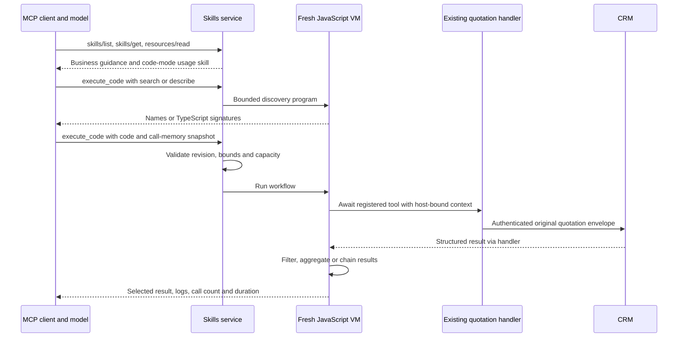

# MCP code mode

The skills service exposes an opt-in code-mode endpoint at `/mcp/code`. An MCP
client uses `execute_code` to discover tools, inspect their signatures, run a
JavaScript workflow and return selected results to its model. The implementation
is in `services/skills-mcp/code_mode.go` and `protocol.go`.

## Design inputs

- FastMCP describes progressive tool discovery, schema lookup and sandboxed
  execution, including an overall deadline covering backend calls. This design
  makes discovery available within the execution API. [FastMCP code mode](https://gofastmcp.com/docs/servers/transforms/code-mode)
- Anthropic describes keeping intermediate results inside an execution
  environment, filtering them before returning to the model and using skills as
  reusable procedural guidance. The existing skill resources supply that guidance
  here. [Code execution with MCP](https://www.anthropic.com/research/code-execution-with-mcp)
- Cloudflare describes generated TypeScript interfaces, disposable sandboxes and
  host-mediated tool access. Here, each invocation gets a new QuickJS WebAssembly
  runtime and host-side business handlers. [Cloudflare code mode](https://blog.cloudflare.com/code-mode/)
- Goose describes on-demand discovery, JavaScript orchestration and carrying
  cancellation through the tool execution path. Here, the original MCP handler's
  context, session and request metadata reach nested calls. [Goose code mode](https://goose-docs.ai/docs/guides/managing-tools/code-mode/)

The implementation uses pinned `codemode-go` v0.2.1 and its MCP SDK adapter. Its
runtime embeds a QuickJS build with JavaScript built-ins and a bounded host
bridge, executed through wazero. The skills-service module requires Go 1.27.2 or
newer. [Runtime source](https://github.com/thehumanworks/codemode-go/tree/v0.2.1)

## Request flow



Both endpoints use the runtime bearer credential and the same origin checks.
`/mcp` exposes the original direct quotation tool. `/mcp/code` exposes
`execute_code`. Both serve published business skills, resources and the
`outbound-turn` prompt. Code mode adds a read-only usage skill at
`skill://mcp-code-mode/runtime/SKILL.md`, with a byte count and SHA-256 manifest
through the existing skills extension. Its nested URI keeps it distinct from
operator-created catalog skills. It is discovered explicitly by code-mode clients.

The existing Active Call engine continues to load selected instructions and use
its native asynchronous quotation executor. This change adds a server-side MCP
execution surface. Selecting it requires an MCP client connected to `/mcp/code`.

## Discovery and execution API

Send normal `tools/call` requests with `name` set to `execute_code`. The code is
the body of an async JavaScript function. These discovery calls need only `code`.

```javascript
return await search("quotation");
```

```javascript
return await describe("tools.quote_total");
```

`search` returns bounded matches, names and descriptions. `describe` returns
TypeScript declarations derived from the registered JSON schemas. The resource
`codemode://tools/typescript` provides the complete declarations on demand.
JavaScript executes in the VM. TypeScript declarations provide documentation.

The following `tools/call` parameters show a synthetic comparison. A real client
must supply the current call's authoritative snapshot.

```json
{
  "name": "execute_code",
  "arguments": {
    "call": "synthetic-example",
    "memory_version": 7,
    "memory": {"quote": {"交强险": true, "三者险": "200万"}},
    "catalog_revision": 1,
    "timeout": "120s",
    "code": "const q = await tools.quote_total({configs: [{\"三者险\": \"200万\"}, {\"三者险\": \"300万\"}]}); return q;"
  }
}
```

Read the revision from the code-mode skill's
`_meta["ai.liuchuanming.golive/code-mode"].catalog_revision`. An optional
`catalog_revision` mismatch fails before execution. Each request holds one
catalog snapshot. Publishing new settings atomically replaces both endpoint
servers for subsequent requests. Already-admitted executions finish against
their starting snapshot.

The outer `state` object supplies confirmed state to every nested `skills_*`
call. Omission supplies an empty state.

The outer `call`, `memory` and `memory_version` fields overwrite script-provided
values for every business call. A script cannot switch calls or change the
confirmed base snapshot. A missing call ID causes quotation validation to fail.
The authenticated MCP caller remains responsible for choosing an authorized call
and supplying fresh memory. The MCP service has no connection to live engine
memory with which to verify that snapshot.

`quote_total` uses the original CRM adapter, argument validation, configured
deadline, pricing rules and structured result. A `need` result requires the
existing intake flow. The model may compose subsequent arguments from a returned
result, but confirmed working memory is owned by the caller. New business tools
must be registered on both endpoint branches with their typed handler and
appropriate context binding.

## Bounds and errors

| Bound | Value |
| --- | --- |
| Source | 32 KiB |
| Outer memory JSON | 64 KiB |
| VM heap | 64 MiB per execution |
| Wall-clock deadline | 90 seconds by default, capped at 180 seconds |
| Host calls | 16 per execution, including discovery |
| Nested dispatch | One call at a time |
| Active executions | Four across all catalog revisions |
| Captured console | 4 KiB character budget |
| Returned result | 24 KiB character budget |

`Promise.all` is valid syntax. Nested business dispatch is serialized so a
quotation workflow has at most one backend request in flight. Independent clients
can execute concurrently. Excess admission fails promptly. A smaller caller
deadline takes precedence and cancellation reaches the CRM HTTP request.

The VM provides no host filesystem, environment, credentials, network, timers,
shell or import loader. The runtime creates an empty directory for its sandbox.
The supplied scratch image sets `TMPDIR=/data` so that directory can be created
under the existing writable mount. Service process memory includes Go, WebAssembly
and compilation overhead in addition to the JS heap budget.

Successful structured content includes `ok`, `result`, `calls`, `elapsed_ms` and
`truncated`, plus `logs` when present. A truncated result becomes a clipped string
and must be treated as incomplete. Runtime failures include an error and available
execution metadata. Input/admission failures return MCP `isError` with a text
message. Tool failures reject their JavaScript promises and support `try/catch`.

Every execution is independent. Completed backend effects survive a later script
error or timeout. Cancellation cannot prove that an already-sent remote operation
had no effect. The executor never retries a failed script automatically. Clients
should inspect business outcomes before replaying operations. The response's call
count includes discovery and attempted calls, and does not certify successful
business effects.

## Run the step-through demo

From the repository root, run

```sh
python3 scripts/demos/code-mode.py --race
```

The runner executes `TestCodeModeWalkthrough` through the actual HTTP MCP endpoint
and JavaScript sandbox. It loads and verifies the code-mode and quotation skills,
selects the quotation skill for a caller utterance, discovers the tool, reads its
signature and executes a two-option comparison. The CRM returns synthetic fixture
prices. The JavaScript is prewritten, so this demonstration establishes protocol
and execution behavior without a model-generation dependency.

The output directory defaults to `outputs/code-mode-demo`; `--output PATH` chooses
another location. `trace.json` contains the captured requests and responses.
`code-mode-demo.html` lets you step through that recorded run and expand each
request and response. Navigation replays recorded evidence. Rerun the Python
command to execute the workflow again.

## Local verification

From `services/skills-mcp`, run

```sh
go test -race ./...
go vet ./...
CGO_ENABLED=0 GOOS=linux GOARCH=amd64 go build -o /tmp/skills-mcp-code-mode .
```

`code_mode_test.go` exercises the HTTP endpoint and MCP transport with a local
synthetic CRM. Coverage includes discovery, skill resources, chained calls,
context binding, schema validation, partial failure, publication, isolation,
heap and call limits, output truncation and cancellation. These checks establish
local protocol and execution behavior. Production performance and call experience
require separate measurement.
