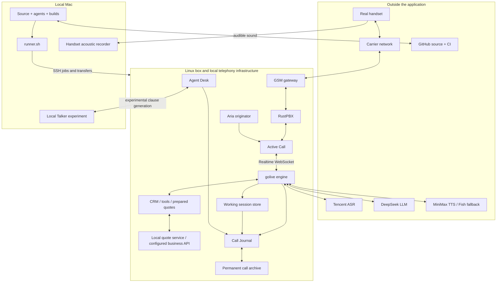

# golive architecture and component documentation

[Open the interactive architecture explorer](explorer.html)

golive is a concurrent voice-conversation service. It keeps listening while it recognizes speech, reasons about what to say and plays an answer. The current phone implementation combines Tencent recognition, DeepSeek reasoning and MiniMax synthesis with local turn control, quotation tools and retained call evidence.

This documentation describes `codex/telephony-latency` at **9547d22**, inspected on **31 October 2026**. The architecture is a source/configuration snapshot, not a live service-health dashboard. The last deployment verified during this work was 9547d22. Values in checked configuration files are distinguished from measured results; historical runbooks can describe older deployments.

## Explore by concern

| Guide | What it explains |
| --- | --- |
| [1. The phone call](01-phone-call.md) | Handset, carrier, GSM gateway, RustPBX, Active Call and Aria |
| [2. Conversation engine](02-conversation-engine.md) | Session protocols, continuous listening, ASR, turn control, LLM, TTS, playback, cache and focus |
| [3. Business and quotations](03-business-and-quotations.md) | CRM, templates, working memory, async tools, pricing integrations and prepared results/audio |
| [4. Recordings and evidence](04-recordings-and-evidence.md) | Working store, permanent archive, Journal, Desk, telemetry and handset measurement |
| [5. Development and deployment](05-development-and-deployment.md) | Mac, runner.sh, GitHub, CI, release verification, browser demo and tunnel boundaries |
| [7. Streaming coordination](07-streaming-coordination.md) | ASR partials, early final, speculation, commitment, text/audio streaming, interruptions and timing |
| [6. Simulator and model lab](06-simulator-and-model-lab.md) | Synthetic customer, Talker, edge models and diagnostic tools |

Each component has its own section with responsibility, deployment boundary, location, inputs, outputs, operation, limitations and implementation/runbook links. The explorer contains the same component descriptions. Select a view and a node to highlight its incoming and outgoing relationships. The whole-system view also shows the other connections faintly. Source links in the explorer point to the inspected commit; Markdown links open the local checkout.

## System at a glance



The GSM gateway is local hardware in the telephony environment; it need not be a process hosted by the Linux box. RustPBX, Active Call and Aria are adjacent systems integrated by this repository, not components implemented by its Go packages. External can therefore mean a separately maintained local system or a remote vendor; the detailed guides state which.

## Five distinctions that matter

1. **Protocol and model are different.** The service speaks gpt-live-1 and OpenAI Realtime-shaped events. It implements the behaviour with an ASR → LLM → TTS cascade, rather than one native full-duplex audio model.
2. **Filler and answer are different.** A cached acknowledgement can start promptly while reasoning, a quotation or synthesis is still running. First audio, first content and quotation readout need separate measurements.
3. **Talker and the phone's phrase cache are different.** The Mac model has a Desk playground and a Journal health probe. The inspected phone engine does not call that model for its fillers.
4. **CI and deployment are different.** GitHub runs validation. Explicit runner jobs transport and install the verified build, preserve state and check the resulting processes.
5. **Server recording and handset evidence are different.** The Journal's recording is essential call evidence but omits physical transport to the phone. The <1200 ms handset p95 goal is not yet established.

## Where state lives

| State | Owner / location | Persistence |
| --- | --- | --- |
| Turn state, memory, prepared audio | Live engine | Call/process scoped |
| Prompt templates, config versions, rendered prompts | `~/golive-crm` | Private files and checksummed event history |
| Local pricing vehicle/rating data | `~/golive-quotesvc` | Private tables and quote event history |
| Working PCM + session metadata | `~/golive-calls` | Retention-managed; current operational setting 720 hours |
| Verified completed call artifacts | `~/golive-archive` | Permanent local archive; mirroring is separate |
| Notes, owner controls and work logs | `~/golive-desk` | Private participant-authenticated records |
| Scenario/run reports | Separate simulator data directory | Managed by the simulator deployment |
| Sanitized retrospectives/issues/decisions | Repository `journal/` | Version controlled and served by Journal |
| Code, tests and deployment procedures | GitHub + local Git | Commit history |

This is primarily a file-backed system. The documented core does not require a separate SQL database, Redis or a message broker: asynchronous tasks and call memory are managed inside the service, while durable records are explicit files/logs.

## Main interfaces

| Interface | Consumer | Purpose |
| --- | --- | --- |
| WS `/v1/live/sessions` | Native/browser clients | gpt-live-1 session contract |
| WS `/v1/realtime` | Active Call | Telephony-compatible session contract |
| HTTP `/v1/opening` | Originator integration | Associate/release the opening for a call |
| HTTP `/api/tools/quote` on CRM | Tool coordinator | Calculate or obtain a quote |
| HTTP `/api/quote/ready` on CRM | Prepared-audio worker | Read eligible call-bound quote results |
| WS `/verify` on :8032 | Focus path | Target-speaker similarity evidence |
| HTTP `/api/calls/<id>` on Journal | UI and collection tooling | Selected call evidence and archive status |
| HTTP `/healthz`, `/readyz`, `/metrics` | Operators/probes | Process identity, readiness and counters |
| SSH/SCP through runner.sh | Authorized release jobs | Remote execution and artifact transport |

Exact protocol schemas, limits and alternate modes remain in the source and [main README](../../README.md). Operator procedures are in [CALL-OPERATIONS.md](../../CALL-OPERATIONS.md), telephony details in [TELEPHONY.md](../../TELEPHONY.md), and physical measurement in [HANDSET-LATENCY.md](../../HANDSET-LATENCY.md).

## Scope and maintenance

The architecture includes implemented packages, checked configuration and separately maintained systems described by the runbooks. Optional fallback, edge models, simulator and intranet integration are labelled accordingly. Documented hostnames/ports are not assertions of current availability. The unrelated untracked `playground/` is excluded from this commit-based map.

The component source of truth for these guides is [components.json](components.json); diagram relationships are in [views.json](views.json). Update these and the explanatory sections in [build.py](build.py), then regenerate with:

```sh
python3 docs/architecture/build.py
```

The generator validates IDs, complete component coverage and local source references. The resulting [explorer.html](explorer.html) is self-contained and uses no network calls, external assets or credentials. Opening it cannot dial, deploy or modify a service. Source links are ordinary navigation links to GitHub. Existing private prompts, recordings and provider keys are not embedded.
