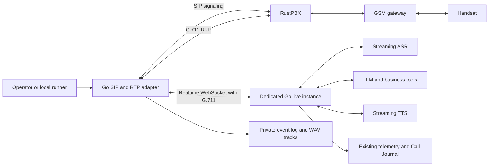

# Experimental outbound SIP/RTP adapter

## Purpose and boundary

This second outbound approach keeps RustPBX and the GSM gateway, but replaces
Active Call with a Go transport that we own. The first version is an explicit
one-call command. A persistent dial API, campaign scheduler and CRM dial button
can wrap it later without changing the media contract.



Depending on PBX topology, the SDP media peer may be RustPBX or the gateway.
The adapter sends to that exact negotiated address. GoLive still owns VAD,
endpointing, speculative generation, LLM/tools, TTS and interruption decisions.
It converts G.711 for its internal pipeline. The adapter forwards wire audio
without transcoding; it decodes a separate copy for recordings only.

## Runtime behavior

1. Validate private configuration, lock the record directory, and check that the
   dedicated agent is idle, has capacity one and holds its opening.
2. Reserve a new call ID on disk. Reusing it fails even after a restart.
3. Connect Realtime with `?call=<id>`, negotiate PCMA or PCMU, and wait for
   `session.updated` before sending SIP INVITE.
4. Handle an INVITE digest challenge if required. Accept one bidirectional G.711
   stream on an allowed unicast IPv4 address. Discard pre-answer media.
5. ACK the answer, enable both media directions and release the named opening.
6. Forward incoming RTP immediately. Discard duplicates/late packets; count
   losses and fill timestamp gaps up to 200 ms with silence.
7. Send outgoing audio in 160-byte, 20 ms packets. Send the first complete frame
   immediately, then pace without catch-up bursts. Pad a final partial frame.
8. On GoLive's accepted barge-in event, clear queued audio and tombstone its
   response IDs. Delayed interrupted chunks cannot restart playback.
9. Stop media and hang up on remote BYE, signal, agent disconnect, overflow or
   duration limit. ACK/BYE a late answer racing cancellation. Wait up to 33
   seconds for cancellation completion and three seconds for BYE acknowledgement.
   Network failures may still need PBX timeout cleanup; events record failures.

The 500 ms default queue limit is a **ceiling**, not added prebuffering. It
accommodates the existing engine's 300 ms playback lead. Overflow ends the call
instead of accumulating unlimited delay. Defaults: 30 seconds ringing and
600 seconds connected duration.

## Prepare an isolated box experiment

```sh
go build -o /tmp/golive-telephony ./cmd/golive-telephony
go build -o /tmp/golive-sip-agent ./cmd/golive
```

Copy [the adapter config](../../configs/sip-adapter.example.json) and
[the call config](../../configs/sip-call.example.json) to a private directory
outside Git, with mode 0600. Set the authorized destination, PBX identity and
the actual `go-gpt-live-1` instructions in these private files. The call file
cannot override the destination or agent URL. Assign a fresh ID for each call.

Create a separate agent profile from the current telephony profile:

```sh
python3 scripts/prepare_sip_adapter.py \
  --base /private/golive/telephony.json \
  --output /private/golive/sip-agent.json \
  --state-dir /var/lib/golive-sip-ab
```

Substitute actual private paths. The script creates a new file and refuses to
overwrite one. It preserves provider/tool/endpointing/playback settings, but sets
port 9875, capacity one, opening hold 180 seconds and separate stored-call paths.
It clears `hangup_url`: this experiment must not call production Active Call's
`:8081` hangup endpoint. The adapter hangs up when its agent connection closes.

```sh
/tmp/golive-sip-agent -profile /private/golive/sip-agent.json \
  -env /private/golive/providers.env -addr 127.0.0.1:9875
```

Use a provider-only env file. Inherited `GOLIVE_*` overrides can undo profile
isolation; inspect the effective settings locally without publishing secrets.
Keep this instance exclusive to the adapter: the legacy `/v1/opening` endpoint
falls back to other held sessions when a named call is absent. Capacity one,
exclusive use and the successful session handshake are required here.

| Configuration | Meaning |
| --- | --- |
| `sip_listen` | Signaling bind address; default `127.0.0.1:15060` |
| `advertise_ip` | Reachable IPv4 address published in SIP/SDP |
| `pbx` | Fixed outbound proxy; normal box RustPBX uses port 5060 |
| `allowed_uri` | Authorized number in the PBX's required SIP routing syntax |
| `from_user`, `sip_username` | Identity accepted by existing PBX routing/authentication |
| `media_networks` | Allowed SDP media peers; loopback default only suits a local relay |
| `rtp_min`, `rtp_max` | Default 31000–31031, separate from existing production ranges |
| `codec` | `pcma` (PT8) or `pcmu` (PT0), 8 kHz, one codec per call |
| `record_dir` | Private records and one-call lock; share it across invocations |

For a LAN media peer, bind `0.0.0.0:15060`, advertise the actual box LAN address,
and allow only the necessary gateway/PBX media addresses. Limit network access
to those peers. This version requires a trusted UDP network and existing PBX
source ACL/routing or INVITE digest authentication; it does not register an
extension. Credentials come from `GOLIVE_SIP_PASSWORD` and
`GOLIVE_ADAPTER_TOKEN` (the dedicated agent's bearer token, if enabled), not JSON.

## Operate

Readiness check, which does not dial:

```sh
/tmp/golive-telephony -config /private/golive/adapter.json
```

Exactly one real call:

```sh
/tmp/golive-telephony -config /private/golive/adapter.json \
  -call /private/golive/call.json -dial
```

Ctrl-C/SIGTERM ends the call; allow SIP cancellation to finish. There is no
automatic redial. `.active-call` locks the record root. After a crash, confirm
the call has ended in the PBX before removing a stale lock. Keep call-ID
directories to retain duplicate protection. Readiness does not prove PBX routes,
provider quotas or handset audibility.

## Records and external systems

Each call directory contains private files:

- `events.jsonl`: SIP status, answer/hangup, transcript completions, playback
  clearing, and `first_rtp.enqueue_to_send_us` for each response.
- `inbound.wav`, `outbound.wav`: 8 kHz PCM16 mono, sharing a monotonic origin,
  with gaps preserved. Normal cleanup finalizes the WAV headers.
- `summary.json`: packet, loss, queue, rejection and interruption counters.

SIP Call-ID is `<call-id>@<advertise-ip>`; Realtime and existing GoLive telemetry
use the original call ID. The profile generator preserves the telemetry
destination and enables GoLive stored calls in a separate directory. It does
**not** import adapter WAVs into the Call Journal UI or add an adapter dial
button. These recordings measure the adapter boundary, never handset playout.

## Limits and verification

Outbound-only, UDP/IPv4, G.711. No REGISTER, inbound answering, transfers,
re-INVITE negotiation, DTMF, TLS/SRTP, ICE/STUN, RTCP reporting or adaptive jitter
buffer. PBX routing/media rewriting must match this contract. Silence suppression
between responses is intentional; check gateway RTP timeout behavior in the
live interoperability test. Synchronous recording needs fast local storage;
slow disks can affect timing and must be included in the A/B observation.

Tests cover actual GoLive with mock providers, two-way byte-preserving audio,
pre-answer isolation, framing/pacing, malformed packets, SDP allowlists, packet
loss/wrap, stale-response cancellation, digest/rejection, late-answer cleanup,
remote BYE, duplicate IDs and aligned recordings. CI places synthetic calls only.

Use the [latency report and A/B procedure](sip-adapter-latency.md) before normal
use. Rollback is stopping the experimental processes and continuing with the
existing Active Call runner. This branch does not modify live production services.

The [expanded simulation report](sip-adapter-simulation.md) covers fault injection,
the complete mock speech pipeline, repeated race tests and parser fuzzing.

The [2026-10-31 hangup investigation](2026-10-31-sip-hangup.md) documents the
sustained-playback pacing defect found in the first isolated handset test,
its fix, and the longer playback regressions added afterward.
