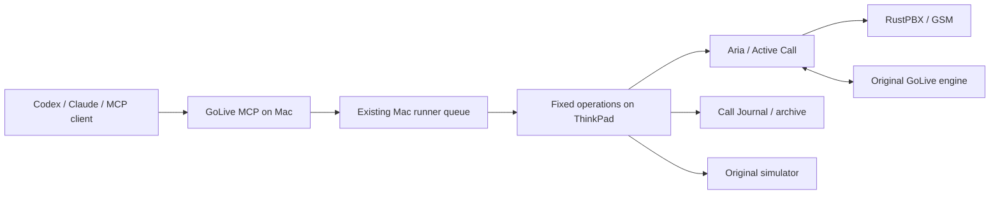

# GoLive plugin

A local operations plugin for the existing GoLive Active Call deployment. It
includes Codex and Claude Code manifests, a standard MCP stdio server, and three
Agent Skills. It uses the existing Mac runner to reach the ThinkPad. The audio
pipeline and services remain where they run today.



## Install

Requires Python 3.11+, `uv`, the existing Mac runner with SSH access, and the
current box layout under `~/golive-telephony`, `~/golive-sim`, `~/aria`,
`~/golive-archive` and `~/golive-last-call.json`. Box services use their existing
ports, 8765 for GoLive, 3000 for Aria, 8791 for CRM, and 18087 for the optional
detector. The box needs Python 3.10+ and `ss` for recording preflight.

From this plugin directory

```bash
uv sync --frozen
mkdir -p "$HOME/.config/golive"
# Copy only if a configuration does not already exist.
test -e "$HOME/.config/golive/mcp.json" || cp config.example.json "$HOME/.config/golive/mcp.json"
chmod 600 "$HOME/.config/golive/mcp.json"
```

Edit that local config for the existing runner directory, Journal URL and
**already existing** remote staging directory. The sample matches the current
Mac/ThinkPad layout. It contains no credentials. `GOLIVE_MCP_CONFIG` can select
another file. Real and simulated calls are separately disabled until the host
sets `allow_real_calls` / `allow_sim_calls` to `true`. A mode being enabled is
not authorization to call; the skill requires an owner request.

For Claude Code, load this directory as a local plugin

```bash
claude --plugin-dir /absolute/path/to/plugins/golive
```

For a Codex plugin loader, use `.codex-plugin/plugin.json`, which references
the bundled skills and `.mcp.codex.json` with plugin-relative working directory.
The manifests follow the installed Codex plugin layout. UI installation depends
on the host's plugin loader; no marketplace publication is implied.

For any MCP client, install the built wheel and configure stdio with
`command` set to the absolute path of `golive-mcp` in that environment, no args,
and optionally `GOLIVE_MCP_CONFIG` in its environment. For a source checkout,
use the absolute path to `uv` and

```json
{
  "mcpServers": {
    "golive": {
      "command": "/absolute/path/to/uv",
      "args": ["run", "--frozen", "--no-dev", "--directory", "/absolute/path/to/plugins/golive", "golive-mcp"]
    }
  }
}
```

Cursor supports this generic MCP configuration. To use the skills without a
plugin loader, copy the three directories in `skills/` into the host's supported
skills directory. Remove the client registration/skill copies to uninstall;
this does not stop box services or delete call records.

## Tools and workflow

| Tool | Result |
| --- | --- |
| `golive_get_status` | Engine/binding/config hashes, Journal settings, detector readiness |
| `golive_list_calls` | Bounded page of call IDs and recording flags |
| `golive_list_scenarios` | Deployed simulator names, hashes and name conflicts |
| `golive_get_call` | Exact call metadata, transcript counts, private playback links |
| `golive_place_call` | One Active Call or one simulator call, guarded and deduplicated |
| `golive_analyze_call` | Verified archive, normal response, quotation and interruption metrics |
| `golive_get_operation` | Poll a request receipt without repeating its operation |

Resources `golive://architecture` and `golive://operations` explain the service
and rules. Prompt `review_call` prepares a selected-call review.

Every box operation returns a request UUID immediately. Poll
`golive_get_operation` until completed, then inspect `result.ok` and `data`.
`completed` means the operation returned, not that a phone call ended. Calls
require the inspected `state_sha256` and a caller-supplied request UUID. Reusing
that UUID with identical arguments polls its receipt; changed arguments fail.
Remote receipts also prevent replay if a Mac receipt is lost. An unknown result
requires inspection of the same attempt, never an automatic redial.

Typical examples

- “Check the service” → status → poll → report health/binding and configuration hashes.
- “Call me” → status → poll → `active_call` with one UUID → poll → retain call ID → wait for `done`.
- “Call sim, interruption scenario” → status → poll → `sim` with a deployed scenario name → poll → follow call ID → analyze when ended.
- “Done, compare interruptions” → get the selected call → poll → analyze with `owner_done=true` → poll; repeat for the exact comparison call.

The package does not implement Speko, restart, deployment, arbitrary shell,
transcript export or owner-feedback writes. The optimization skill explains
how to use the existing repository workflow for authorized code/deployment work.
There are no startup hooks or calls on installation.

## Evidence and privacy

The worker checks the actual GoLive process recording environment, Aria's local
binding, original preset policy, idle state, saved context hashes and 365-day
retention before dialing. Archive verification checks five files and both audio
channels. Raw chat/audio, tokens, prompts and recipient numbers remain on the box.
Journal links are private LAN links and may reveal call content when opened.

Normal responses exclude quotation-origin acknowledgments in the additional
normal-only metric. Canonical gate behavior remains visible separately. Quotation
results/readout are reported separately; calculation-only phases still require
the existing CRM review. Interruption timing starts at VAD utterance-open and
ends at server playback cut, excluding pre-VAD and network/playout delay.
The optional +50ms handset assumption is labeled estimated. No server metric
establishes acoustic handset latency.

The runner executes one queued job at a time. Plugin instances share a local
lock, but manual enqueuers must still follow the single-operator rule. The
worker uses a separate box call lock and rechecks idle state before dialing;
unrelated operators are not controlled by that lock. Do not run competing calls
through Aria while this operator is dialing.

Jobs use only fixed operations, transfer the packaged worker, verify its bytes
before execution, and return only marked JSON. Runner output is never forwarded
wholesale. Provider exceptions are reduced to their type. The worker uses the
box's existing `scripts/call_latency.py` and returns its SHA for reproducibility.

## Validation record

On 2026-11-06, 37 automated checks passed on Python 3.11, 3.12 and 3.13, including an MCP stdio client session,
duplicate and uncertain call handling, real/simulator route isolation, live
recording guards, archive integrity, quotation separation and interruption
pairing, concurrent duplicate submissions, interrupted queue publication, corrupted
worker bytes under Python optimization, and malformed runner results. The additional
62 canonical latency tests and 10 simulator-retrospective tests passed.
Claude's plugin manifest validator and all three skill validators passed.
The manifest validator reported only an optional marketplace-listing icon warning.

A read-only smoke check through the existing Mac runner confirmed engine
`b51e959`, zero active sessions, Aria's original local binding, preset openers,
Journal retention of 8760 hours, detector readiness and 27 deployed simulator
scenarios. A full MCP-to-runner-to-box check also listed calls, retrieved selected
call metadata and verified/analyzed the already-ended `out-mvzfq218-qbqy` archive.
It reproduced the historical 14 normal responses at 1302 ms p95 and 11 server
interruption cuts at 407 ms p95. The historical latency gate correctly remained
failed. These checks validate the plugin, not a new latency improvement.
This packaging check did not dial, run a simulator conversation,
restart a service or establish new latency results. The new call path is covered
by fake-service tests; a real plugin-driven call remains a future owner-requested test.

## Build and test

```bash
uv sync --frozen --group dev
uv run --frozen pytest
uv build
python3 scripts/package.py
uv run --frozen python scripts/verify_dist.py
```

The zip in `dist/` contains only an explicit allowlist of plugin files, including
manifests, skills, source, tests and dependency lock. The wheel is the standalone MCP
server. Tests use temporary queues, synthetic archives and fake services, plus
an actual MCP stdio client. They never dial or restart production. The analyzer
integration test additionally requires the source repository and skips when the
zip is unpacked separately. The runtime analyzer remains installed on the box.
The distribution verifier checks reproducible ZIP bytes, installs a clean ZIP
and wheel, starts both plugin MCP configurations and the wheel entry point,
and verifies discovery, resources, prompts and disabled-call behavior. It does
not install into your regular client or submit runner jobs. CI runs this verifier
before uploading artifacts.

The MCP implementation uses the official Python SDK's supported 1.x API with a
`<2` bound and a committed resolution lock. Protocol and packaging references
are [MCP tools](https://modelcontextprotocol.io/specification/2025-11-25/server/tools),
[Python SDK 1.x](https://github.com/modelcontextprotocol/python-sdk/tree/v1.x), and
[Claude plugin manifests](https://code.claude.com/docs/en/plugins-reference).
