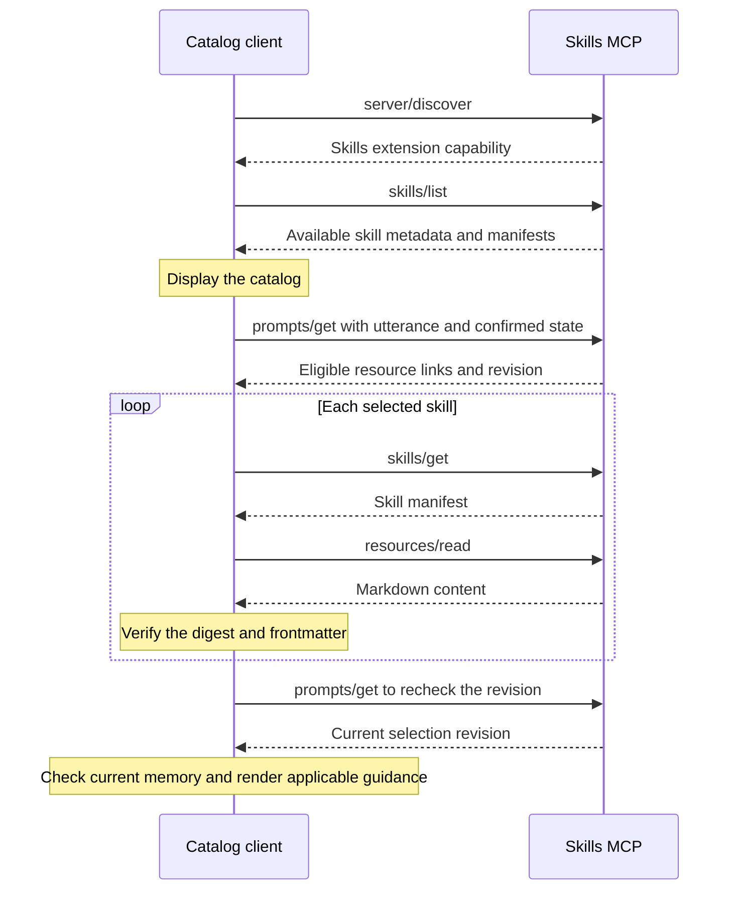
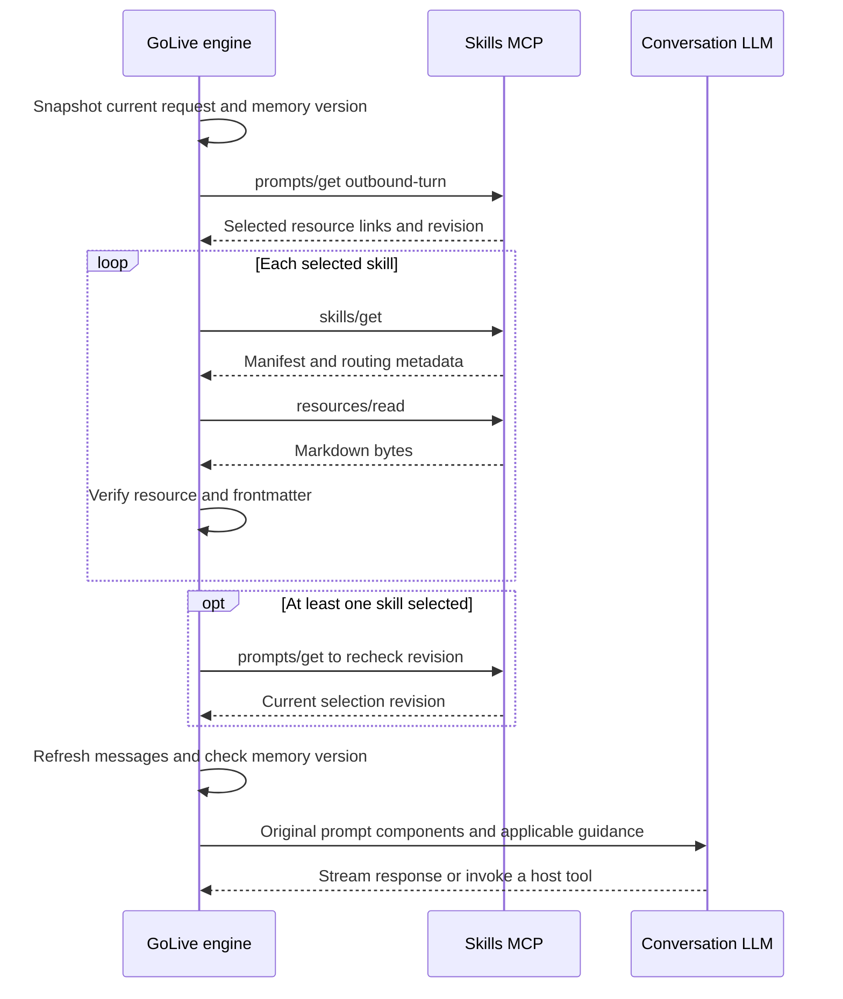

# Xiaocui skills MCP server developer API

This guide describes the implementation reviewed on 2026-11-10, including optional v2 prompt rendering. The service advertises `xiaocui-skills` version `1.1.0`, persists catalog schema `3`, and uses MCP Go SDK `v1.8.0`. Release commit, advertised service version, catalog schema and catalog revision are independent values.

The server maintains business instructions, selects applicable skills, publishes verified Markdown resources, exposes a quotation tool and stores callback response templates. GoLive owns session memory, prompt assembly, conversation generation and audio scheduling. Active Call currently executes quotations through GoLive's native executor. An independent MCP client can execute the server's `quote_total` tool.

## Contents

- [Addresses and authentication](#addresses-and-authentication)
- [Quick start](#quick-start)
- [MCP transport](#mcp-transport)
- [Discovery and resources](#discovery-and-resources)
  - [skills/list workflow](#skillslist-workflow)
- [Skill selection](#skill-selection)
- [Quotation tool](#quotation-tool)
- [Admin HTTP API](#admin-http-api)
- [Catalog schema and limits](#catalog-schema-and-limits)
- [Callback response resources](#callback-response-resources)
- [GoLive integration](#golive-integration)
- [Failures and operational limits](#failures-and-operational-limits)
- [Development and deployment](#development-and-deployment)

## Addresses and authentication

| Surface | ThinkPad address | Authentication | Purpose |
| --- | --- | --- | --- |
| MCP | `http://127.0.0.1:8794/mcp` | Runtime bearer | Discovery, selection, resource reads, quotation execution |
| Admin catalog | `http://127.0.0.1:8794/admin/catalog` | Admin bearer | Read and publish the full catalog |
| Admin preview | `http://127.0.0.1:8794/admin/preview` | Admin bearer | Evaluate published routing rules |
| Operator panel | `http://127.0.0.1:8794/` | Shell loads publicly, admin requests require bearer | Edit skills, routing, quotation settings and callback templates |
| Health | `http://127.0.0.1:8794/healthz` | Public | HTTP 200 with `ready` and a newline |
| CRM upstream | `http://127.0.0.1:8791/api/tools/quote` | Separate CRM bearer | Execute the underlying quotation request |

The process listens on ThinkPad loopback. The usual Mac tunnel maps `http://127.0.0.1:18794/` to that service. `127.0.0.1` always refers to the machine running the client.

```sh
ssh -NT -o ExitOnForwardFailure=yes -o ServerAliveInterval=30 \
  -L 127.0.0.1:18794:127.0.0.1:8794 chuanming@192.168.71.9
```

| Credential | Container path | Default host source | Consumer |
| --- | --- | --- | --- |
| Runtime | `/run/secrets/runtime` | `~/golive-skills-mcp/secrets/runtime` | GoLive and other MCP clients |
| Admin | `/run/secrets/admin` | `~/golive-skills-mcp/secrets/admin` | Panel and catalog publisher |
| CRM | `/run/secrets/crm` | `~/golive-crm/api.token` | Server-to-CRM requests |

Credentials are trimmed when read and must contain at least 16 bytes. Admin and runtime values must differ. Authentication compares the exact `Authorization: Bearer <token>` header. Each protected surface accepts its corresponding credential. Read tokens from private files and keep them out of command arguments, logs and committed examples.

When `Origin` is present, the server currently accepts only `http://` followed by the request's `Host`. An incompatible origin returns HTTP 403. The supported browser setup is the same-origin panel over loopback or its SSH tunnel. HTTPS reverse-proxy deployment needs a reviewed origin-handling change.

## Quick start

Run this Python 3 example on the ThinkPad using its existing runtime credential. It performs discovery, selects a synthetic WeChat turn and verifies retrieved Markdown. For a Mac client, set `SKILLS_MCP_BASE` to the tunnel URL and `SKILLS_MCP_TOKEN_FILE` to an authorized local runtime credential file.

```python
import hashlib
import itertools
import json
import os
from pathlib import Path
from urllib.request import HTTPRedirectHandler, Request, build_opener

BASE = os.environ.get("SKILLS_MCP_BASE", "http://127.0.0.1:8794").rstrip("/")
TOKEN_FILE = Path(os.environ.get(
    "SKILLS_MCP_TOKEN_FILE",
    str(Path.home() / "golive-skills-mcp/secrets/runtime"),
))
TOKEN = TOKEN_FILE.read_text().strip()
VERSION = "2026-07-28"
ids = itertools.count(1)

class NoRedirect(HTTPRedirectHandler):
    def redirect_request(self, req, fp, code, msg, headers, newurl):
        return None

opener = build_opener(NoRedirect())

def rpc(method, params=None, timeout=5):
    request_id = next(ids)
    params = dict(params or {})
    params["_meta"] = {
        "io.modelcontextprotocol/protocolVersion": VERSION,
        "io.modelcontextprotocol/clientInfo": {
            "name": "xiaocui-api-example", "version": "1"
        },
        "io.modelcontextprotocol/clientCapabilities": {
            "extensions": {"io.modelcontextprotocol/skills": {}}
        },
    }
    headers = {
        "Authorization": "Bearer " + TOKEN,
        "Content-Type": "application/json",
        "Accept": "application/json, text/event-stream",
        "Mcp-Protocol-Version": VERSION,
        "Mcp-Method": method,
    }
    if method in ("prompts/get", "tools/call"):
        headers["Mcp-Name"] = params["name"]
    elif method == "resources/read":
        headers["Mcp-Name"] = params["uri"]
    body = json.dumps({
        "jsonrpc": "2.0", "id": request_id,
        "method": method, "params": params,
    }).encode()
    request = Request(BASE + "/mcp", data=body, headers=headers)
    with opener.open(request, timeout=timeout) as response:
        message = json.load(response)
    if message.get("id") != request_id:
        raise RuntimeError("Mismatched JSON-RPC response")
    if "error" in message:
        raise RuntimeError(message["error"])
    result = message["result"]
    if result.get("isError"):
        raise RuntimeError(result.get("content", "Tool execution failed"))
    return result

discovery = rpc("server/discover")
assert "io.modelcontextprotocol/skills" in discovery["capabilities"]["extensions"]
catalog = rpc("skills/list")
assert catalog["resultType"] == "complete"
print(json.dumps({"available_skills": [
    {"name": entry["frontmatter"]["name"], "uri": entry["uri"]}
    for entry in catalog["skills"]
]}))
selection = rpc("prompts/get", {
    "name": "outbound-turn",
    "arguments": {
        "event": "auto",
        "utterance": "微信服务通知在哪里找？",
        "state": json.dumps({"wechat.status": "consented"}),
    },
})
for message in selection["messages"]:
    link = message["content"]
    expected = link["_meta"]["ai.liuchuanming.golive/turn"]
    skill = rpc("skills/get", {"uri": link["uri"]})["skill"]
    assert skill["resources"] == [expected]
    resource = rpc("resources/read", {"uri": link["uri"]})["contents"][0]
    raw = resource["text"].encode("utf-8")
    assert resource["uri"] == link["uri"]
    assert resource["mimeType"] == "text/markdown"
    assert len(raw) == expected["size"]
    assert "sha256:" + hashlib.sha256(raw).hexdigest() == expected["digest"]
print(json.dumps({"matched_skills": len(selection["messages"])}))
```

The example's five-second per-request timeout supports manual inspection. A conversational client needs a total selection-and-retrieval deadline, final catalog-revision validation, frontmatter validation and a session-memory version check. GoLive implements those checks with a default 150 ms budget.

## MCP transport

Runtime calls use JSON-RPC 2.0 over `POST /mcp`. The server uses stateless Streamable HTTP with JSON responses. The repository client supplies protocol version `2026-07-28` and discovery metadata on each request. Use the quick-start helper to construct the headers and metadata shown above.

```json
{
  "jsonrpc": "2.0",
  "id": 42,
  "method": "skills/list",
  "params": {
    "_meta": {
      "io.modelcontextprotocol/protocolVersion": "2026-07-28",
      "io.modelcontextprotocol/clientInfo": {
        "name": "my-client",
        "version": "1"
      },
      "io.modelcontextprotocol/clientCapabilities": {
        "extensions": {"io.modelcontextprotocol/skills": {}}
      }
    }
  }
}
```

Subsequent JSON examples show method parameters or result bodies as labeled. Wrap parameters in this envelope, or pass them to `rpc`. Clients using the SDK's legacy initialization should let their SDK negotiate transport and use `skill://index.json` when they lack the skills extension.

| Method | Parameters | Result |
| --- | --- | --- |
| `server/discover` | Empty object plus metadata | Server information and capabilities, including the skills extension |
| `skills/list` | Optional empty `cursor` | `resultType: complete`, `skills` entries |
| `skills/get` | `uri` | `resultType: complete`, one `skill` entry |
| `resources/list` | SDK list parameters | Available resource metadata |
| `resources/read` | `uri` | `contents` with resource text and MIME type |
| `prompts/list` | SDK list parameters | `outbound-turn` metadata and argument descriptions |
| `prompts/get` | `name`, `arguments` | Selected skill resource links and selection metadata |
| `tools/list` | SDK list parameters | Currently enabled tools and generated JSON schemas |
| `tools/call` | `name`, `arguments` | Tool content, structured result or tool error |

The service implements `skills/list` and `skills/get` as custom methods for the `io.modelcontextprotocol/skills` extension. Use capability discovery before relying on them. `prompts/get`, `resources/read` and `tools/call` use MCP's corresponding methods. SDK-generated optional fields may be omitted from examples.

## Discovery and resources

### skills/list workflow

Use `skills/list` to discover the available catalog before presenting a skill browser or building a client-side selection workflow. A listing describes availability across the catalog. Eligibility for a particular utterance and confirmed session state is evaluated by `prompts/get` with `name=outbound-turn`.

Using the quick-start helper, the discovery operation takes this form.

```python
catalog = rpc("skills/list")
for entry in catalog["skills"]:
    print(entry["frontmatter"]["name"], entry["uri"])
```

The following abbreviated response illustrates the shape. Each real entry includes the manifest and routing metadata described below.

```json
{
  "resultType": "complete",
  "skills": [
    {
      "uri": "skill://vehicle_insurance_concepts/SKILL.md",
      "frontmatter": {
        "name": "vehicle_insurance_concepts",
        "description": "Explain vehicle insurance concepts."
      }
    }
  ]
}
```

The verified ThinkPad catalog exposes `motor-quotation`, `wechat-service-notification` and `vehicle_insurance_concepts`. Availability changes after an operator publishes. The listing supplies metadata and content digests. Clients retrieve a selected skill's Markdown with `resources/read`. Keep the original bytes when verifying the SHA-256.



This diagram shows a catalog-browsing client followed by a matched turn. In the current GoLive engine, automatic preparation starts directly with `prompts/get`. The service performs selection from its current catalog, so the engine can retrieve eligible skills without fetching the whole list on every turn. `internal/skillsmcp.Client.Catalog` implements discovery for clients that need it. Automatic preparation records the requests it actually sends in Call Journal.

A client maintaining a skill browser can call `skills/list` again when refreshing it. In this implementation, resource digests identify the listed content. Catalog revisions accompany turn selections. Use the turn selection's revision and subsequent verification for a consistent prompt snapshot. The complete workflow and host checks are in [GoLive integration](#golive-integration).

### Skill entries

`skills/list` returns every available skill in catalog order. Availability requires `enabled=true` and an enabled quotation tool when `tool=quote_total`. An empty cursor is accepted. A nonempty cursor returns JSON-RPC `-32602` with `unknown cursor`. The implementation returns the complete list in one response.

`skills/get` accepts a skill resource URI.

```json
{"uri":"skill://wechat-service-notification/SKILL.md"}
```

Each entry has these fields.

| Field | Type | Meaning |
| --- | --- | --- |
| `uri` | string | Canonical `skill://<name>/SKILL.md` URI |
| `frontmatter.name` | string | Validated unique skill name |
| `frontmatter.description` | string | Human/model-facing description |
| `resources` | array | One manifest containing `uri`, `size`, `digest` |
| `resources[].size` | integer | UTF-8 byte length of the complete published Markdown |
| `resources[].digest` | string | `sha256:` followed by the complete Markdown's hex digest |
| `_meta["ai.liuchuanming.golive/routing"].events` | string array or null | Explicit event bindings |
| Same metadata's `state` | object or null | Required projected state values |
| Same metadata's `tool` | string | Empty string or `quote_total` |

Unknown and unavailable URIs return JSON-RPC `-32602` from `skills/get`. Disabling a skill removes its discoverable entry and Markdown resource. Disabling quotation also withdraws dependent skills.

### Resource representations

| URI | MIME type | Content |
| --- | --- | --- |
| `skill://index.json` | `application/json` | Compatibility discovery index |
| `skill://<name>/SKILL.md` | `text/markdown` | Generated frontmatter and configured body |
| `golive://event-responses/addV` | `application/json` | Current callback response binding |

`resources/read` returns a `contents` array. JSON resource payloads are encoded as a string in `contents[0].text` and need a second JSON parse. Markdown needs its exact original bytes for integrity checks.

The compatibility index has `$schema` set to `https://schemas.agentskills.io/discovery/0.2.0/schema.json` and a `skills` array. Each item contains `type: skill-md`, `name`, `description` and `url`.

The Markdown format uses exactly two JSON-quoted YAML frontmatter fields, followed by the body.

```markdown
---
name: "example-skill"
description: "Example business instructions"
---

Ask one question at a time.
```

The digest covers frontmatter, whitespace and body. The server configures zero cache lifetime and private cache scope. HTTP responses carry `Cache-Control: no-store`.

## Skill selection

Call `prompts/get` with `name=outbound-turn`. All prompt argument values are strings, including the serialized `state` object.

```json
{
  "name": "outbound-turn",
  "arguments": {
    "event": "auto",
    "utterance": "把三者险改成三百万，其他不变，请重新算一下。",
    "state": "{\"wechat.status\":\"consented\"}"
  }
}
```

| Argument | Required | Contract |
| --- | --- | --- |
| `event` | Yes | `auto` or an explicit event matching `^[a-z][a-z0-9_]*(\.[a-z][a-z0-9_]*)*$`, at most 96 bytes |
| `utterance` | For useful automatic matching | Current user text, at most 24,000 bytes |
| `state` | Optional | Serialized flat JSON object of string values, at most 8,192 bytes, default empty object |

Use `{"wechat.status":"consented"}` as projected state. A nested `wechat` object is incompatible with the prompt's string-valued map. Explicit event matching uses exact event membership and all state guards. Automatic selection evaluates each skill's exclusion patterns, requires a match pattern, requires at least one event binding, then checks availability and state. The implementation uses that skill's first configured event for the internal membership check. It does not classify the utterance into a specific event among that skill's bindings.

Patterns use Go's `regexp` syntax. Match within the utterance unless explicitly anchored. Every configured state key must equal one of its allowed strings. Missing keys fail guards. Multiple matching skills retain catalog order. Their tool names are deduplicated.

Selection results contain these fields.

| Field | Meaning |
| --- | --- |
| `_meta["ai.liuchuanming.golive/turn"].revision` | Catalog revision used for selection |
| Same metadata's `auto_selection` | `true`, the capability marker required by GoLive automatic selection |
| Same metadata's `tools` | Deduplicated dependent tool names |
| Same metadata's `prompt_rendering.version` | `1` for appended guidance or `2` for the host's `skill_content` slot. Omission by an older server means `1`. |
| `messages[].role` | `user` in the MCP prompt result |
| `messages[].content.type` | `resource_link` |
| `messages[].content.uri/name/description/mimeType` | Selected skill resource metadata |
| Content `_meta["ai.liuchuanming.golive/turn"]` | Exact file manifest |
| Content `_meta["ai.liuchuanming.golive/tool"]` | Empty string or tool dependency |

An empty match returns `messages: []`. Clients must not interpret the MCP message role as permission to append arbitrary returned content directly to the conversation. GoLive verifies resources and constructs its own scoped system guidance.

### Seed scenarios

Operator edits can change these default outcomes.

| Event or automatic utterance | Projected state | Seed result |
| --- | --- | --- |
| `conversation.normal` | Any | Empty selection |
| `quote.requested`, `quote.revised`, `quote.compare` | Any | `motor-quotation` |
| `wechat.add_requested`, `wechat.notification_help` | `consented` or `awaiting_confirmation` | `wechat-service-notification` |
| Same explicit WeChat events | `unknown`, `declined`, `added` or absent | Empty selection |
| `请按现有方案给我报个价` with `auto` | Any | `motor-quotation` |
| `微信服务通知在哪里找？` with `auto` | `consented` | `wechat-service-notification` |
| `接下来呢？` with `auto` | `consented` | `wechat-service-notification` |
| `不要给我报价了` with `auto` | Any | Empty selection |

The short continuation pattern is state-gated and can match without an explicit WeChat word. Evaluate new routing rules against unrelated conversation as well as intended matches.

## Quotation tool

Use `tools/list` to obtain the current `quote_total` description and SDK-generated input schema. Publication can update its description, enabled state and execution timeout. `tools/call` arguments are JSON values.

```json
{
  "name": "quote_total",
  "arguments": {
    "call": "synthetic-quote-example",
    "memory_version": 3,
    "memory": {"quote": {"交强险": true, "车损险": true, "三者险": "200万"}},
    "config": {"三者险": "300万"}
  }
}
```

| Argument | Type | Contract |
| --- | --- | --- |
| `call` | string | Required host-provided call ID, nonblank, at most 256 bytes |
| `memory_version` | integer | Optional, defaults to zero, must be nonnegative |
| `memory` | object | Current confirmed call memory, including the full base plan under `quote` |
| `config` | object | Changes to the base coverage selection |
| `configs` | object array | Up to 16 alternative changes for comparison |

For comparison, replace `config` with `configs`, such as `[{"三者险":"200万"},{"三者险":"300万"}]`. Explicit removal uses `false`. The adapter forwards both fields when both are supplied, and the CRM decides their combined semantics.

The server sends one authenticated CRM request per invocation with this envelope.

```json
{
  "tool": "quote_total",
  "call": "synthetic-quote-example",
  "memory_version": 3,
  "memory": {"quote": {"交强险": true, "车损险": true, "三者险": "200万"}},
  "arguments": {
    "config": {"三者险": "300万"},
    "configs": null
  }
}
```

Inspect the MCP result's `isError` first, then `structuredContent.status`.

| Status | Typical CRM fields | Client action |
| --- | --- | --- |
| `need` | `plan`, `missing`, `known`, `instruction` | Ask for the next required input and update confirmed memory |
| `quote` | `total`, `currency`, `lines`, `selection`, `rules_version`, `rules_sha`, `memory_version`, `computed_at`, `compute_ms` | Validate result applicability and present returned amounts |
| `quote` with comparison | Base quote plus `variants` | Present each variant's result and any variant error |

These fields depend on the configured CRM backend. The adapter validates only that the upstream JSON is an object with status `need` or `quote`, then returns the object through `structuredContent`. Use the CRM definitions for detailed result schemas. [Quotation types](../../internal/crm/quote.go), [intake types](../../internal/crm/plans.go), [comparison types](../../internal/crm/compare.go).

The quotation deadline defaults to 90 seconds and can be configured from 5 to 180 seconds. The server rejects upstream redirects, non-200 responses, payloads over 1 MiB and unrecognized result status. Failures become MCP tool errors. Raw upstream error bodies are excluded from the error text. The adapter makes a single attempt. Retried client invocations can trigger another CRM operation, so the host must own retry policy and result validity.

Record submission, conversational acknowledgment, calculation and result delivery as separate timings. Preserve the configured calculation delay when comparing conversational latency.

## Admin HTTP API

These endpoints use the admin bearer and plain HTTP JSON. The panel uses the same endpoints.

### GET /admin/catalog

Returns the complete persisted catalog, including disabled skills. The `revision` is the optimistic concurrency token for the next publication.

### PUT /admin/catalog

Publishes a full replacement catalog. Start from a fresh GET, modify the relevant fields and submit the full object with its current revision. Fields omitted from the replacement are subject to their Go zero values and validation. Retain other skills and settings when making a targeted edit.

On success, the server validates the catalog, acquires its publication lock, compares revisions, increments the revision, builds the replacement MCP server, writes and syncs a temporary catalog file, renames it into place and swaps the in-memory catalog/server. Requests already using the previous server can finish against their captured revision. Later requests use the published revision.

| HTTP status | Meaning |
| --- | --- |
| 200 | Saved catalog returned with incremented revision |
| 400 | Invalid JSON, unknown fields, trailing JSON or validation failure |
| 401 | Invalid or missing admin bearer |
| 403 | Rejected origin |
| 409 | Submitted revision differs from the current catalog |
| 500 | Catalog persistence failed |

On 409, reload the current catalog and reconcile the intended edit before resubmitting. A publication that fails to persist leaves the in-memory catalog unchanged. The deployment supports one catalog writer process and one replica. Its lock is process-local.

### POST /admin/preview

Evaluates the currently published catalog using plain JSON.

```json
{
  "event": "auto",
  "utterance": "微信服务通知在哪里找？",
  "state": {"wechat.status": "consented"}
}
```

Here `state` is an object. The response contains `revision`, `skills` as complete matching catalog skill objects, `tools` as dependent names and `prompt_rendering` with the effective `version`. Preview performs selection only. For v2, the panel also displays its entered original prompt followed by selected skill bodies in `<additional_skill_instructions>`. The engine supplies its own current host policy and working memory during actual rendering. Generation and quotation execution require their own APIs.

For a read-only check of the published insurance skill, preview `{"event":"auto","utterance":"交强险一般保障什么？","state":{}}`. On ThinkPad revision 8 the response contains one skill named `vehicle_insurance_concepts` and an empty `tools` array. A fresh installation must publish the skill or restore a catalog containing it to reproduce this result. [Skill instructions](vehicle_insurance_concepts/SKILL.md) · [Routing rules](vehicle_insurance_concepts/routing.json).

Malformed input or invalid routing input returns 400. The preview decoder currently accepts extra fields and does not enforce the strict trailing-data checks used by catalog PUT. Send only the documented fields.

## Catalog schema and limits

This is a minimal complete schema-3 catalog example with synthetic business instructions. Use a freshly fetched revision when publishing it. Publishing this example replaces the catalog's skill list with its single example skill.

```json
{
  "schema": 3,
  "revision": 1,
  "skills": [
    {
      "name": "wechat-example",
      "description": "Guide a consenting caller to the service notification.",
      "body": "Ask which WeChat screen the caller sees. Give one confirmed step at a time.",
      "enabled": true,
      "events": ["wechat.notification_help"],
      "match": ["(微信|服务通知).*(哪里|怎么|找)"],
      "exclude": ["(不要|不想).*(微信|添加)"],
      "state": {"wechat.status": ["consented", "awaiting_confirmation"]}
    }
  ],
  "quote_total": {
    "enabled": true,
    "description": "Calculate or revise the confirmed insurance selection.",
    "timeout_seconds": 90
  },
  "event_responses": {
    "addV": {
      "enabled": true,
      "templates": ["微信已经添加成功了，我们继续刚才的话题。"]
    }
  }
}
```

| Field | Validation and behavior |
| --- | --- |
| `schema` | Must be `3` on publication |
| `revision` | Must equal the current revision, incremented by the server |
| `prompt_rendering` | Optional object. Omission or `null` means version 1. |
| `prompt_rendering.version` | Required integer inside that object, either `1` or `2`. Other values fail publication. |
| `skills` | At most 64 entries |
| Skill `name` | Unique, at most 64 bytes, `^[a-z0-9]+([-_][a-z0-9]+)*$` |
| Skill `description` | Nonblank, one line, at most 1,024 Unicode characters |
| Skill `body` | Nonblank, at most 65,536 UTF-8 bytes, supplied without generated frontmatter |
| Skill `enabled` | Boolean availability switch |
| Skill `tool` | Optional empty string or `quote_total` |
| Skill `match` and `exclude` | At most 32 patterns combined, each 1–1,024 bytes and valid Go regexp |
| Skill `events` | At most 32 identifiers, each at most 96 bytes and matching the event grammar |
| Skill `state` | At most 16 keys, each at most 96 bytes and matching the event grammar |
| Each state's allowed values | 1–32 strings, each nonblank and at most 128 bytes |
| `quote_total.description` | Nonblank, at most 4,096 bytes, validated even when the tool is disabled |
| `quote_total.timeout_seconds` | Integer from 5 through 180, validated even when disabled |
| `event_responses` | Optional object, currently accepts only key `addV` |
| Event `templates` | At most 12 distinct strings, 1–300 Unicode characters each, single-line, trimmed, no NUL |
| Event `enabled` | When true, requires at least one template |

Authenticated request bodies are capped at 2 MiB. A schema-valid catalog can still produce a runtime response larger than GoLive's 512 KiB response limit, or match more than its four-skill limit. Keep selected guidance within both client limits.

On startup, historical schema-0 catalogs migrate through the earlier tool-binding layout. Schema-2 catalogs migrate to schema 3, adding default routing patterns to recognized seed skills where patterns are absent. Operator content and existing rules are retained according to those migrations. Catalog PUT requires schema 3. Keep a compatible catalog snapshot with each deployment rollback.

## Callback response resources

Read the current addV binding with `resources/read`.

```json
{"uri":"golive://event-responses/addV"}
```

Decode the returned `text` as JSON.

```json
{
  "revision": 7,
  "event": "addV",
  "enabled": true,
  "templates": [
    "微信已经添加成功了，我们继续刚才的话题。",
    "已经加上微信了，我们接着说刚才的问题。"
  ]
}
```

Revision 7 illustrates the response shape. Clients use the revision actually returned. The resource always exists. A missing catalog binding produces `enabled=false` and may serialize `templates` as null.

GoLive receives the external completion event through `POST /v1/calls/{call_id}/events` on its own engine, authenticated with `GOLIVE_BUSINESS_EVENT_TOKEN`. This HTTP callback invokes the same internal handler as the session's `golive.business.event` WebSocket extension. Its payload is shown below. Use a real active call ID and `source: tracking` for a verified production event.

```json
{"name":"addV","event_id":"synthetic-event-uuid","source":"simulation"}
```

After applying `wechat.status=added`, GoLive reads the MCP resource under the configured skills deadline, randomly chooses one line, and queues verbatim speech through its normal player. Caller speech, model output, pending tools and quotation delivery can postpone that announcement. A received 202 means the callback was queued. It does not establish that the line has already played.

The state update survives missing, disabled or unavailable response configuration. Repeated addV delivery is idempotent within the session. The event ID supports correlation, while deduplication is based on session completion state. A callback already being handled keeps its fetched template revision. Future callbacks observe the next published revision. The external producer must verify the customer action and resolve the matching active call. [Complete callback API and status codes](../../docs/services/tracking-events.md).

## GoLive integration

Configure the host with a runtime credential and memory enabled.

```json
{
  "tools_memory": true,
  "skills_mcp": {
    "url": "http://127.0.0.1:8794/mcp",
    "token_file": "/home/chuanming/golive-skills-mcp/secrets/runtime",
    "timeout_ms": 150,
    "state_keys": ["wechat.status"]
  }
}
```

`GOLIVE_SKILLS_MCP_URL` and `GOLIVE_SKILLS_MCP_TOKEN_FILE` override those two fields. An empty URL disables retrieval. The configuration requires a token file and `tools_memory=true` when retrieval is enabled. URLs allow HTTPS, or HTTP with hostname `127.0.0.1` or `localhost`, and reject embedded credentials, query strings and fragments. `timeout_ms` accepts 0–1000, with zero selecting the 150 ms default. An omitted `state_keys` uses `wechat.status`. An explicit empty array projects no keys. Projection includes string-valued fields only.



For `N` selected skills, normal retrieval performs `2 + 2N` MCP requests. Zero matches require one request. The total retrieval deadline covers all of them. GoLive accepts at most four matching skills and requires `auto_selection=true` and a positive catalog revision. It verifies the manifest, URI, UTF-8 size, SHA-256, MIME type and two-field frontmatter. Any failed check falls back for that retrieval.

| Preparation status | Prompt treatment |
| --- | --- |
| `loaded` | Apply verified guidance using the selected renderer. Preserve its URI, digest, turn scope and memory version. |
| `no_match` | Use existing prompt components |
| `unavailable` | Use original components with an instruction to use known steps and clarify missing information |
| `expired` | Discard retrieved guidance and rebuild from current memory with fallback instructions |
| `cancelled` (Journal trace) | The preparation observed cancellation. The superseded generation stops. |

Network work runs on the generation worker. Message snapshots and memory checks run on the engine loop. Guidance applies to the current turn under original instructions, business state and host tool permissions. Interruption cancels the old generation context. Authoritative completed or declined WeChat state is applied even when retrieval fails.

The production Go client falls back when the catalog changes during retrieval. The Python reference `turn_renderer.py` performs at most two attempts on catalog changes and supports host-supplied origin/digest acceptance and tool allowlisting. Its output is a component contract. The Go engine's `snapshotMessages` and `prepareSkills` implement production prompt assembly. [Rendering guide](../../docs/architecture/09-skills-prompt-rendering.md).

### Optional v2 host rendering

Fetch the current catalog, set `prompt_rendering` to `{"version":2}`, and PUT the complete document with its current revision. The panel's **Prompt rendering** selector performs this operation. Version 1 is the default. The effective version arrives in the same selection response and revision as the skill manifests, so choosing v2 adds zero network requests.

The compatible GoLive engine substitutes its existing system prompt into `{{ original_prompt }}` and the verified selected Markdown bodies into `{{ skill_content }}`. The fixed host template places the skill slot inside an `additional_skill_instructions` section after the original component. Bodies are joined in catalog order. Substitution is single-pass and preserves literal template syntax inside values. The original prompt stays on the host. It is not sent to the MCP server for rendering.

The first system message carries the filled template. A separate scoped guidance envelope carries provenance without duplicating the body. Existing history, state constraints and tool schemas keep their normal placement. No-match requests use the original system prompt directly. Retrieval failures and unsupported rendering versions use the original-prompt fallback. Publishing version 1 restores appended guidance on the next model request. Executable support requires deployment of both this server and the compatible engine. Older clients ignore this additive metadata and continue their own rendering. [Implementation and message ordering](../../docs/architecture/09-skills-prompt-rendering.md#optional-v2-skill-content-slot).

## Failures and operational limits

Distinguish HTTP failure, JSON-RPC error and MCP tool error when handling a request.

| Condition | Observable behavior | Handling |
| --- | --- | --- |
| Invalid credential | HTTP 401, bearer challenge | Check token role and configured private file |
| Rejected origin | HTTP 403, `untrusted origin` | Use the supported same-origin endpoint or tunnel |
| Unsupported admin catalog method | HTTP 405 with `Allow: GET, PUT` | Use the supported method |
| Catalog revision race | HTTP 409 | GET current catalog and reconcile the edit |
| Invalid skill URI or list cursor | JSON-RPC `-32602` | Refresh discovery or correct the request |
| Invalid prompt input | JSON-RPC invalid-params error | Correct event, utterance or projected state |
| Unknown resource or MCP method | SDK JSON-RPC error | Handle the returned code/message without assuming tool-error shape |
| Quotation execution failure | Result with `isError=true` | Handle failure before reading `structuredContent` |
| No skill applies | Successful empty `messages` | Continue with original prompt |
| GoLive deadline, integrity or version failure | Host preparation fallback | Preserve current state and original behavior |

| Limit | Value |
| --- | --- |
| HTTP read-header / read / write / idle timeouts | 5 / 15 / 200 / 45 seconds |
| Authenticated request body | 2 MiB |
| CRM result body | 1 MiB |
| GoLive MCP response body | 512 KiB |
| GoLive decoded event response text | 20,000 bytes |
| Default conversational retrieval budget | 150 ms total |
| Default tool execution budget | 90 seconds |

Health reports that the HTTP process is serving. It does not probe CRM execution or prove that a particular skill matches. GoLive logs `skills: prepare` with status and elapsed milliseconds. Callback logs include `business: response prepared` and `business: response started`. Correlate these with session, turn, memory and catalog revision in host instrumentation. Speech scheduling timestamps and audible output timestamps represent different stages.

## Development and deployment

The service is a separate Go module under `services/skills-mcp`. Run its checks from that directory.

```sh
go test -race ./...
go vet ./...
python3 -m unittest test_turn_renderer.py
```

The Go tests use isolated HTTP fixtures for MCP and CRM. They cover discovery, publishing, credentials, routing, migration, quotation envelopes and callback configuration. The installed `python3 smoke.py` additionally calls the configured CRM once with synthetic data and tests reference-renderer scenarios.

The release uses a static Linux executable in a scratch image, host networking, the configured host UID/GID, a read-only root filesystem, dropped capabilities and private mounted secrets. `STACK_DIR/data` is the writable persistence mount. The default stack root is `~/golive-skills-mcp`.

| Setting | Source | Default or requirement |
| --- | --- | --- |
| `RELEASE` | Installer/Compose | Required immutable release tag |
| `STACK_DIR` | Installer/Compose | `~/golive-skills-mcp` |
| `CRM_TOKEN_FILE` | Installer/Compose | `~/golive-crm/api.token` |
| `SERVICE_UID`, `SERVICE_GID` | Installer | Current installing user's UID/GID |
| Listener, CRM URL, container secret paths, catalog path | Executable | Fixed in `main.go` |

Publish catalog content through the admin API for immediate next-request activation. Executable changes require a release deployment. Use the established Mac runner for box operations and the service installation runbook for packaging and rollback. Save the current catalog, release identity and matching configuration before a schema upgrade. Restore a schema-compatible catalog when reverting the executable. [Maintenance and migration runbook](OPERATIONS.md), [local operations](../../scripts/local-ops/README.md).

### Adding a capability

For a guidance-only workflow, add a skill with a unique name, body, events, patterns and state guards, then preview and publish it. For a new executable tool, add a typed handler, register it in `buildServer`, extend allowed tool bindings and availability logic, update configuration and panel support where needed, and add protocol tests. Integrating that tool into Active Call also requires its host binding or an explicit MCP execution adapter. For another callback event, extend catalog validation, resource registration, GoLive ingress/state handling and client validation together.

### Source map

| Source | Responsibility |
| --- | --- |
| [main.go](main.go) | HTTP routes, authentication, origin checks and process configuration |
| [catalog.go](catalog.go) | Schema, validation, manifests, persistence, migrations and revision control |
| [protocol.go](protocol.go) | MCP methods and resource registration |
| [routing.go](routing.go) | Explicit and automatic selection, prompt result metadata |
| [quote.go](quote.go) | Tool input and CRM request/result adaptation |
| [event_responses.go](event_responses.go) | Callback template validation and resource representation |
| [panel/panel.js](panel/panel.js) | Editor and preview client |
| [turn_renderer.py](turn_renderer.py) | Reference host composition contract |
| [internal/skillsmcp/client.go](../../internal/skillsmcp/client.go) | Production retrieval and verification |
| [internal/duplex/skills.go](../../internal/duplex/skills.go) | Turn scope, freshness and fallback |
| [internal/duplex/think.go](../../internal/duplex/think.go) | Final model-request assembly |
