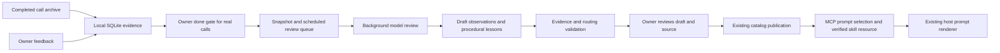

# Dreaming memory v1

An optional, local experience store and deferred review worker for the existing
skills-over-MCP service. Nothing is enabled without `GOLIVE_DREAM_DB`. The voice
engine, saved prompt, call routing, and authoritative business tools are unchanged.



## What the first version does

- Keeps immutable episodes, original archive JSON/checksum, projected evidence,
  audio references, and separately submitted owner feedback in SQLite.
- Reviews one to ten completed episodes together, allowing cross-call pattern
  detection and consolidation. A model can identify mistakes without owner feedback.
- Records a distinct model observation and proposed procedure with evidence IDs.
  The observation is a diagnosis to review, not an established fact.
- Validates cited evidence, bounded text, regex syntax, and both positive and
  negative retrieval examples. Exact repeated lesson text within one dream is
  deduplicated. Model output never publishes itself.
- Publishes a reviewed procedure as a normal `memory-<id>` skill through the
  existing revision check. The existing `prompts/get` → `skills/get` →
  `resources/read` flow and digest verification apply. Rendering v1 and v2 work;
  v2 uses the existing `{{ skill_content }}` slot.
- Requires explicit acknowledgement to publish lessons based on simulations.
  V1 publishes reusable procedures only, not personal facts or cached prices.

This implements external memory consolidation, not model weight training or
Google's Sleep algorithm. It is inspired by the separation of online action from
offline consolidation in [Sleep](https://research.google/blog/the-sleep-framework-a-new-way-for-llms-to-retain-knowledge-in-continual-learning/),
the [dynamic dreaming workflow](https://platform.claude.com/cookbook/managed-agents-cma-dreaming-with-a-dynamic-workflow),
[agent memory components](https://www.anthropic.com/research/components-of-agent-memory),
[Managed Agents Dreams](https://platform.claude.com/docs/en/managed-agents/dreams),
and [FrontierMemory](https://frontiermemory.com/). No hosted memory service is required.

## Enable in an isolated instance

| Variable | Meaning |
| --- | --- |
| `GOLIVE_DREAM_DB` | SQLite file, e.g. `/data/memory/experiences.sqlite`; unset disables memory routes and worker |
| `GOLIVE_DREAM_MODEL_URL` | Full OpenAI-compatible chat-completions URL; unset enables capture/review APIs without running queued jobs |
| `GOLIVE_DREAM_MODEL` | Explicit review model identifier |
| `GOLIVE_DREAM_TOKEN_FILE` | File holding its bearer credential; never reused from CRM/runtime credentials |

Only HTTPS or HTTP with a loopback IP is accepted for the model. Redirects are
rejected. Requests use JSON response mode and require a completed single-choice
response with `finish_reason: stop`. Providers must support this contract.

`compose.dreaming.yaml` is an opt-in overlay for the Linux deployment. The scratch
image needs the overlay's read-only CA bundle mount for a remote HTTPS provider.
Set `DREAM_TOKEN_FILE`, `GOLIVE_DREAM_MODEL_URL`, and `GOLIVE_DREAM_MODEL`, then use
`docker compose -f compose.yaml -f compose.dreaming.yaml ...` in an isolated stack.
Do not use this command to restart an active call service. Configure the Journal connection described above before deploying automatic capture.

The model receives projected transcript, timing/tool evidence and owner feedback.
Original archive JSON and audio paths remain local; audio is never opened or uploaded.
A remote review endpoint therefore receives conversational data when explicitly
configured. Use a local compatible endpoint when that data must stay on the host.

The worker is serial and runs outside MCP request handling, with a 90-second review
deadline. A structurally valid model response that fails proposal validation gets
one repair attempt with the failing lesson/case index under that same deadline.
The worker validates the repaired result before storing drafts.
`not_before` schedules an explicitly queued review. The worker also requires
continuous voice-engine idle time before starting and defers when activity
resumes. Automatic capture defaults to enabled for newly completed calls,
with a 30-second idle delay. The Journal Dreaming setup controls this policy.
See [automatic capture and connection setup](../../journal/DREAMING.md#automatic-review-and-live-status).
Automatic review is standing authorization to release these completed calls.
the explicit release endpoint remains available for manually imported calls.

## API and review workflow

All routes below require the **admin** bearer token; runtime credentials cannot
read private evidence, queue jobs, release calls or publish lessons. Paths begin
with `/admin/memory`. JSON rejects unknown fields. Existing request limit is 2 MiB.

| Method and path | Input / result |
| --- | --- |
| `GET /status` | `worker_enabled` |
| `GET /live` | Activity, collector, settings, capture outcomes and latest 100 job summaries |
| `GET /jobs/{id}` | Latest 100 process events, candidate lessons and current publication states |
| `PUT /settings` | Revision-checked enabled flag, idle seconds and simulation policy |
| `POST /episodes` | Immutable completed episode below; returns its ID |
| `POST /episodes/{id}/release` | `{"owner_done":true}` after the owner finishes the real call |
| `POST /feedback` | `{"episode_id":"call1","id":"feedback1","text":"…"}` |
| `POST /dreams` | `{"id":"review1","episode_ids":["call1"],"not_before":"2026-12-01T01:00:00Z"}`; omit `not_before` for the next worker pass |
| `GET /dreams/{id}` | Status, immutable evidence snapshot, schedule and redacted failure category |
| `POST /dreams/{id}/retry` | Requeue a failed job using the same snapshot |
| `GET /lessons` | First 1,000 drafts in ID order, source dream IDs, routing examples and current catalog publication state |
| `POST /lessons/{id}/publish` | `{"revision":3,"reviewed":true,"allow_simulation_evidence":false}` |

Normalized episode example (closed time must be in the past):

```json
{
  "id": "call1",
  "mode": "real",
  "closed_at": "2026-11-01T08:00:00Z",
  "evidence": [
    {"id":"user1","kind":"user","text":"Please repeat only the price."},
    {"id":"agent1","kind":"assistant","text":"Replayed the entire explanation."}
  ],
  "audio_refs": ["/private/archive/call1/audio.wav"]
}
```

Kinds are `user`, `assistant`, `tool`, and `timing`. Feedback is submitted through
its dedicated endpoint. Importing a real call never releases it, including when
its transcript says “done”. Simulation episodes are immediately review-eligible.
The archive helper requires an explicit mode rather than guessing from a phone number:

```sh
python3 memory_import.py /private/archive/call1/call.json \
  --mode real --token-file /private/secrets/admin \
  --audio-ref /private/archive/call1/audio.wav
```

This copies original `call.json` bytes as UTF-8 text with SHA-256 and projects its
transcript, turn timing, quotation records and warnings. It neither releases nor
queues the call. The server accepts up to 500 evidence items, 16,000 bytes per item,
and 512 KiB per episode/dream snapshot; oversized imports fail instead of silently
truncating evidence. Audio references are references, not proof of audio integrity.

Review each draft against `GET /dreams/{dream_id}` before publication: confirm the
diagnosis, condition/exception, absence of personal data and unsupported business
policy, and routing examples. `reviewed:true` records the caller's explicit choice
to publish; it is not automated verification of truth. Use the existing catalog
GET to obtain the current revision. A stale revision returns 409.

Publication only adds the proposed procedure, not raw evidence or the model's
observation, to the runtime catalog. The existing catalog panel can edit or disable
a published skill. Disabling immediately removes it from subsequent retrieval;
publication retries do not re-enable an edited or disabled skill. A revoked lesson
should remain disabled rather than deleted if retry protection is desired.

## Durability and limits

- The DB file is mode 0600, WAL-backed, with a process lock (Linux/macOS). One
  service owns a database. On restart, interrupted reviews return to pending.
- Import/feedback IDs are immutable: identical retry succeeds, different content
  returns 409. A dream ID pins a request and its evidence snapshot. Later feedback
  requires a new dream ID. Failed jobs require explicit retry; no endless retry loop.
- All proposals are validated before a dream commits. Drafts and completed status
  commit in one SQLite transaction. A model call can repeat after process loss;
  it cannot write runtime instructions itself.
- The existing catalog file is the publication receipt. An identical publish retry
  succeeds without incrementing the revision. There is no claimed transaction
  spanning SQLite and the catalog file. The catalog remains authoritative about
  whether a lesson is available to callers.
- Routing is the existing operator-reviewed regex/event selection, not semantic
  vector search. Each lesson is capped at 3,000 bytes; normal host retrieval limits
  and timeouts still apply. Catalog limit remains 64 total skills. Avoid overlapping
  rules that retrieve many lessons for the same turn.
- No automatic expiration, cross-dream conflict resolution, identity-scoped factual
  memory, embeddings, or automated behavioral promotion yet. No automatic deletion
  or retention policy: protect/back up the DB and its WAL consistently, and manage
  archive retention separately. Disabling a skill does not erase its evidence.

## Verification

The service module requires Go 1.26.11 to include standard-library fixes missing
from the previous 1.26.2 toolchain. The root voice-agent module is unchanged.

```sh
go vet ./...
go test -race ./...
python3 -B -m unittest -v test_turn_renderer test_memory_import
CGO_ENABLED=0 GOOS=linux GOARCH=amd64 go build -trimpath -o /tmp/skills-mcp-dreaming .
```

The end-to-end test uses a **mock model HTTP endpoint**, real SQLite, authenticated
admin HTTP APIs and real MCP protocol calls. It checks both prompt-rendering
versions, manifest hashes, no-match routing, publication retry/revocation, owner
release gates and private-data access. These are integration/contract results,
not evidence of better live-call behavior or lower handset latency. Evaluate a
configured model on held-out completed calls and simulate subsequent behavior
before enabling learned guidance in a live catalog.
